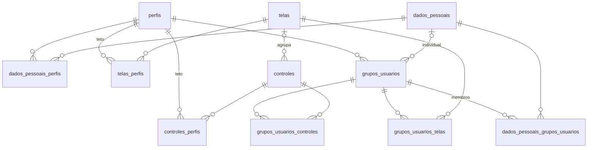

# Brain — Permissões por grupo de usuários: modelagem e regras

> **Para quem implementa:** esta spec define o modelo de dados, a migration inicial, o cálculo da permissão efetiva e como backend e frontend passam a consultá-la. É a fonte da verdade para a migration e para as regras. As decisões de produto foram tomadas em 02/10/2026 e revistas em 05/10/2026, depois que o DIRETOR passou a usar as telas do ADMIN (commit `f2c7c91`) (seção 2).
>
> **Estado (08/10/2026):** na branch `feature/permissoes-grupos`, as permissões valem no frontend: o menu, a guarda de rota e os botões e seções das telas leem `GET /permissoes/me`. O vínculo automático ao grupo padrão no cadastro também já funciona. Ainda falta o backend recusar o que o grupo não libera, na fase F3 (seção 11). A tela de grupos (`/grupos-usuarios`) está pronta desde 06/10, e os acessos individuais (seção 4.1, migration V112) desde 15/10. O acesso individual pode liberar qualquer tela do sistema, e as áreas do backend que já eram restritas por perfil passaram a aceitar também quem tem a tela liberada (D22–D26). A migration da seção 7 foi executada em H2 2.4 (modo PostgreSQL, como nos testes) e em PostgreSQL 15.

---

## 1. Visão geral

Hoje quem decide o acesso é só o **perfil** (`PerfilNome`). O `roles` do [routesConfig.tsx](../frontend/src/constants/routesConfig.tsx) define quais telas cada perfil abre, e constantes espalhadas pelas telas definem o que aparece dentro delas. A escola não consegue, por exemplo, deixar uma secretária fora do CRM ou tirar a ficha médica de quem não precisa dela.

O novo modelo separa duas coisas:

- **Perfil = teto.** É o máximo que uma pessoa daquele perfil *pode* ter. É definido no código e só muda por migration.
- **Grupo = recorte.** É o que a escola *concede*, dentro do teto, a um conjunto de pessoas do mesmo perfil. ADMIN e DIRETOR mantêm os grupos numa tela nova.

Na implantação, cada perfil ganha um grupo padrão com tudo o que já acessa hoje, e cada pessoa entra no grupo padrão de cada perfil que tem. O ADMIN é a exceção: não tem grupo e recebe direto o teto do perfil dele. **No dia 1 nada muda para ninguém.**

## 2. Decisões

| # | Decisão | Consequência no modelo |
|---|---------|------------------------|
| D1 | O grupo restringe dentro do perfil; não substitui o perfil. | Todo grupo pertence a um perfil; o teto fica em `telas_perfis` e `controles_perfis`. |
| D2 | Quem não tem grupo num perfil não acessa as telas desse perfil. No cadastro, a pessoa entra automaticamente no grupo padrão. | Um grupo padrão por perfil, com vínculo automático sempre que um perfil é concedido. |
| D3 | ADMIN não passa por grupos. ADMIN e DIRETOR gerenciam os grupos. | O ADMIN é o único superusuário; os endpoints de gestão exigem ADMIN ou DIRETOR. |
| D4 | Incluir, alterar e excluir são controles, e não flags no vínculo grupo↔tela. | Existe um mecanismo só. |
| D5 | Na primeira entrega do backend, escritas e dados sensíveis passam pela permissão; leituras compartilhadas exigem só login ou perfil. | Seção 8.3. |
| D6 | O menu continua no `routesConfig`; `exibir_menu` no banco é só informativo. | O menu não vem do banco. |
| D7 | Recorte de dados por unidade fica fora. | — |
| D8 (05/10) | O DIRETOR passa por grupos, com teto igual ao que o ADMIN abre hoje e um grupo padrão com tudo isso. | No dia 1, o diretor vê o mesmo que vê desde `f2c7c91`, mas a escola pode restringir. No front, o apelido DIRETOR→ADMIN do `parseRoles` vira um perfil DIRETOR de verdade (seção 9.6). |
| D9 (05/10) | Superusuário é o teto inteiro do perfil, e não "tudo". | O ADMIN recebe, sem grupo, o teto do perfil ADMIN. Situação familiar e atendimento psicológico ficam fora, porque hoje são exclusivos da orientação. |
| D10 (06/10) | A tela de grupos entra antes de as permissões valerem, visível para ADMIN e diretor, com um aviso fixo de que os acessos ainda não estão em vigor. Fica em `/grupos-usuarios`, no menu do ADMIN. | Seção 11. |
| D11 (06/10) | O vínculo automático ao grupo padrão no cadastro fica para depois. **Substituída pela D16.** | Quem foi cadastrado entre a V111 e a D16 ficou sem grupo (D15). |
| D12 (07/10) | Na aba Acessos, as telas aparecem numa lista única em ordem alfabética, sem separar menu de páginas internas e sem agrupar por área. Cada linha mostra nome e rota e se expande para mostrar as ações. | `exibir_menu` deixa de ser usado pela tela de grupos; o catálogo vem ordenado por nome. Seção 9.5. |
| D13 (08/10) | O frontend busca as permissões numa chamada só, `GET /permissoes/me`, ao entrar e a cada carga da página (F5). A resposta traz telas e controles de todos os perfis da pessoa. O check de controle numa tela lê esse cache e não chama a API. | Seção 9.1. Não há endpoint por tela nem por controle. |
| D14 (08/10) | O DIRETOR vira um perfil de verdade no frontend e herda as rotas do ADMIN. | Seção 9.6. |
| D15 (08/10) | Não haverá migration para pôr nos grupos quem ficou de fora. Quem ficou sem grupo num perfil é vinculado à mão, pela tela de grupos; até lá, não abre as telas desse perfil. | Seção 8.4, com a consulta que lista quem está sem grupo. |
| D16 (08/10) | O vínculo automático ao grupo padrão no cadastro (D2) entra junto com a ativação no frontend, e a D11 deixa de valer. | Sem ele, toda pessoa cadastrada depois da ativação cairia em `/sem-acesso`. Seção 8.4. |
| D17 (08/10) | As permissões entram em vigor sem chave de ativação. | O seed da V111 reproduz o acesso de antes, então quem está no grupo padrão não percebe a mudança. Uma chave obrigaria a manter as duas lógicas, por perfil e por grupo, enquanto existisse. |
| D18 (15/10) | Uma pessoa pode ter acessos individuais, além dos grupos dela. O acesso individual é um grupo de uma pessoa só, marcado por `grupos_usuarios.dados_pessoais_id`. | Soma pela mesma regra dos grupos (RP1). `/permissoes/me`, o hook, a guarda de tela e a futura checagem no backend não mudam. Seção 4.1. |
| D19 (15/10) | O acesso individual fica dentro do teto do perfil, como um grupo. **Substituída pela D22.** | — |
| D20 (15/10) | O acesso individual só soma; não retira o que um grupo dá. | Para tirar algo de uma pessoa, monta-se outro grupo sem aquilo e ela muda de grupo. |
| D21 (15/10) | O acesso individual é configurado pela aba Pessoas do grupo, numa página da pessoa que mostra o que já vem dos grupos. Ele vale mesmo para quem não está em nenhum grupo do perfil, e não tem data de validade. | Seção 9.5. A D2 passa a ser lida como "sem grupo nem acesso individual, sem acesso". |
| D22 (15/10) | O acesso individual pode liberar qualquer tela ou controle ativo do sistema, de qualquer perfil, inclusive as telas pessoais (Minhas turmas, Contracheque, as do responsável...). Os grupos normais continuam presos ao teto. | O grupo individual não tem teto: a RV3 vale só para grupos normais, e a consulta da seção 5 não filtra o teto dele. As telas pessoais abrem vazias para quem não é professor, aluno ou responsável. |
| D23 (15/10) | Situação familiar e atendimento psicológico também podem ser liberados no acesso individual, com o aviso "Dado sensível" na linha. | `ControlesSensiveis`, no código. A D9 continua: o ADMIN não os recebe pelo teto. |
| D24 (15/10) | Na página individual, a lista continua única e em ordem alfabética; o que é de fora do perfil leva a etiqueta "De outro perfil". | O catálogo traz `doPerfil` em telas e controles. |
| D25 (15/10) | O middleware passa a exigir só o login para as telas do catálogo; quem decide é a guarda de tela, pelas permissões. Rotas livres continuam presas ao perfil, e rota fora do `routesConfig` continua bloqueada. | Seção 9.3. Quem digita a URL de uma tela que não tem vê um carregamento e é redirecionado pela guarda. |
| D26 (15/10) | As áreas que o backend restringia por perfil (`/crm/**`, `/bolsas/**`, `/simulacoes/**`, `/documentos/**`, `/documentos-escolares/**`) aceitam "o perfil de antes OU uma das telas que as usam liberada". | Só libera: não é o bloqueio da F3. O portal do responsável e a configuração de bolsas continuam só por perfil. Seção 8.2. |

## 3. Conceitos e regras

- **Tela:** página navegável do `routesConfig`. O código é a chave do `RoutesEnum` (ex.: `ALUNO_DETALHE`).
- **Controle:** capacidade dentro de uma tela: aba, seção, botão ou campo. O código segue o formato `DOMINIO.ACAO` (ex.: `FICHA_MEDICA.EDITAR`). Controle sem tela é um **controle de dado** e vale em qualquer tela que mostre aquele dado.
- **Rota livre:** rota fora do catálogo, guardada só pelo perfil: `/`, `/perfil`, `/admin`, `/grupos-usuarios` e `/sem-acesso`.
- **Grupo:** conjunto de telas e controles concedidos a pessoas de um mesmo perfil.
- **Grupo padrão:** existe um por perfil (exceto ADMIN) e recebe automaticamente as pessoas novas do perfil.

**RP1 — Permissão efetiva.** A pessoa tem uma tela (ou um controle) num perfil quando todas estas condições valem:

- algum grupo **ativo** dela, daquele perfil, concede o item;
- ela **ainda tem** o perfil;
- o item está **ativo** e dentro do **teto** do perfil.

As duas últimas condições são checadas na própria consulta (seção 5). Por isso, tirar um perfil da pessoa ou tirar um item do teto já revoga o acesso, sem precisar limpar vínculos.

**RP2 — Grupos só liberam.** O acesso é a união de todos os grupos da pessoa; nenhum grupo bloqueia nada. Para restringir alguém, tire a pessoa do grupo amplo e coloque-a num grupo menor.

**RP3 — Controles são positivos.** Os códigos são sempre `VER`, `EDITAR`, `REGISTRAR` etc., nunca `ESCONDER_X`. Quem não tem o controle não pode.

**RP4 — ADMIN é superusuário do próprio teto.** Recebe, sem grupo, tudo o que está no teto do perfil ADMIN, que reproduz o que ele vê hoje. Não recebe o que está fora desse teto:

- situação familiar e atendimento psicológico, que são só do ORIENTADOR (dados de saúde de menores, exclusivos da orientação no código atual);
- telas de outros perfis, como o calendário e as telas da secretaria.

Se um dia o ADMIN precisar de um desses itens, a mudança é uma migration no teto, e não uma exceção no código.

**RP5 — Frontend por perfil ativo, backend pela união.** O frontend usa as permissões do perfil ativo. O backend não sabe qual é o perfil ativo e usa a união de todos os perfis da pessoa, o que é legítimo, porque ela tem todos eles.

**RP6 — O teto vem do código.** Nenhuma escola concede um item fora do teto. Por exemplo, o teto de atendimento psicológico é ORIENTADOR, então nenhum grupo de secretaria pode recebê-lo.

**RP7 — O que não é permissão.** Estas regras continuam no código, decididas pelo perfil ou pelo dono do dado:

- **Variantes da mesma tela por perfil:** o dashboard em `/`, a fila de atendimento em `/comunicacao`, as páginas do aluno e do professor em `/materiais-complementares`, o seletor de aluno do responsável.
- **Regras de dono:**
  - secretaria e orientação gerenciam só os comunicados que publicaram;
  - o responsável vê só os filhos.
- **Regras de domínio por perfil:**
  - a secretaria não cria nem edita evento de avaliação;
  - a categoria "Atualização RH" fica escondida da secretaria;
  - quem conversa com quem (`ConversaPermissoes`);
  - o teto de bolsa (`BolsaTetoService`);
  - os comunicados visíveis para a gestão (`ComunicadoService.PERFIS_GESTAO`).

O critério: vira controle aquilo que a escola pode querer dar a algumas pessoas de um perfil e não a outras do mesmo perfil.

## 4. Modelo de dados



| Tabela | Dono | Papel |
|---|---|---|
| `telas` | código (migration) | Catálogo de telas. `codigo` é único e igual à chave do `RoutesEnum`. |
| `telas_perfis` | código | Teto: perfis que podem receber a tela. O ADMIN recebe exatamente as linhas do perfil ADMIN. Tela sem nenhuma linha aqui não é de ninguém. |
| `controles` | código | Catálogo de controles. `tela_id` nulo indica controle de dado. |
| `controles_perfis` | código | Teto do controle. |
| `grupos_usuarios` | escola | Grupo de um perfil. A coluna `padrao` marca o grupo padrão; `dados_pessoais_id`, quando preenchida, marca o grupo individual daquela pessoa (seção 4.1). |
| `grupos_usuarios_telas` | escola | Telas concedidas ao grupo. |
| `grupos_usuarios_controles` | escola | Controles concedidos ao grupo. |
| `dados_pessoais_grupos_usuarios` | escola | Pessoas do grupo. |

- **Onde ficam as tabelas.** Todas as tabelas novas ficam no schema de cada escola (`db/migration`), como o resto do sistema. O catálogo sai igual em todas as escolas porque vem da mesma migration; os grupos são de cada escola.
- **Por que `dados_pessoais`.** O vínculo pessoa↔grupo usa `dados_pessoais`, assim como `dados_pessoais_perfis`. É esse o id que o sistema usa como "usuário" (`criado_por`, Envers e `dadosPessoaisId` no JWT).
- **Auditoria.** As quatro colunas de auditoria seguem a `EntidadeBase`. Os grupos e os três vínculos são `@Audited` e têm tabela `_AUD`. Como `store_data_at_delete=true`, o Envers guarda quem tirou o acesso de quem. O catálogo não é auditado, porque só muda por migration.
- **Chaves dos vínculos.** Os vínculos têm `id` próprio, porque precisam das colunas de auditoria e por isso são entidades. Além dele, cada par tem uma chave única (UK).

**Validações no serviço** (o banco não consegue expressar todas):

- **RV1:** o nome do grupo é único por perfil. Já existe uma UK, mas o serviço devolve um erro amigável.
- **RV2:** o perfil do grupo não muda depois de criado. Não existe grupo de ADMIN.
- **RV3:** toda tela e todo controle concedido está dentro do teto do perfil do grupo.
- **RV4:** um controle que pertence a uma tela só pode ser concedido se essa tela também estiver concedida no mesmo grupo.
- **RV5:** as dependências declaradas (seção 6.4) são obrigatórias. Salvar sem elas devolve 422 com a lista do que falta.
- **RV6:** só entra no grupo quem tem o perfil do grupo.
- **RV7:** o grupo padrão não pode ser excluído nem desativado, e não perde a marcação de padrão. Nenhum endpoint cria grupo padrão.
- **RV8:** excluir um grupo remove os vínculos pelo JPA, e não por cascade no banco, para que o Envers registre a remoção.

### 4.1 Acessos individuais (D18–D21)

O acesso individual de uma pessoa num perfil é um grupo comum, com `dados_pessoais_id` apontando para ela. Ela também entra como membro dele, então as consultas da seção 5 já o somam aos grupos dela, sem nenhuma mudança. Uma coluna vazia é um grupo normal.

- **RV9:** cada pessoa tem no máximo um grupo individual por perfil (UK `perfil_id, dados_pessoais_id`).
  - Ele é criado no primeiro acesso individual dado e apagado (pelo JPA, como na RV8) quando fica sem nenhum acesso.
  - O nome é gerado ("Individual: Ana Souza (42)"); o id desempata pessoas com o mesmo nome, porque a UK de nome por perfil continua valendo.
  - Os endpoints de grupo normal não o enxergam: o id dele responde 404, ele não aparece na lista, não é duplicado e não recebe outros membros.
- **RV2 e RV6 valem para ele:** não há acesso individual de ADMIN, e só recebe quem tem o perfil.
- **A RV3 não vale (D22):** o limite é o catálogo inteiro (`CatalogoPermissaoService.todos()`), e não o teto do perfil. Código que não existe ou está inativo é recusado.
- **RV4 e RV5 valem dentro do próprio conjunto individual**, mesmo que um grupo da pessoa já dê o item exigido. Exemplo: liberar individualmente "Ver ficha médica" guarda também a tela "Detalhe do aluno" no grupo individual, ainda que o grupo dela já tenha essa tela. Assim o acesso individual continua funcionando se o grupo mudar depois. Para a pessoa, essa dependência não é um acesso a mais, e a tela e o contador não a contam.
- **Sem `ON DELETE CASCADE`** na chave para `dados_pessoais`, como nos vínculos da V111. O sistema não apaga pessoas.

## 5. Permissão efetiva

São duas consultas por pessoa: uma para telas e outra para controles.

- Elas rodam sob demanda e o resultado é guardado durante a requisição.
- Não há cache entre requisições na v1. Assim, uma mudança num grupo vale já na próxima chamada, e não existe chave de cache que possa misturar dados de escolas diferentes.

```sql
-- Telas. A consulta de controles é igual, trocando telas, telas_perfis e grupos_usuarios_telas.
SELECT DISTINCT p.nome AS perfil, t.codigo
FROM dados_pessoais_grupos_usuarios m
JOIN grupos_usuarios g         ON g.id = m.grupo_usuario_id AND g.ativo = TRUE
JOIN dados_pessoais_perfis dpp ON dpp.dados_pessoais_id = m.dados_pessoais_id
                              AND dpp.perfil_id = g.perfil_id      -- ainda tem o perfil
JOIN perfis p                  ON p.id = g.perfil_id
JOIN grupos_usuarios_telas gt  ON gt.grupo_usuario_id = g.id
JOIN telas t                   ON t.id = gt.tela_id AND t.ativo = TRUE
WHERE m.dados_pessoais_id = :dadosPessoaisId
  AND (g.dados_pessoais_id IS NOT NULL                             -- individual: sem teto (D22)
       OR EXISTS (SELECT 1 FROM telas_perfis tp
                  WHERE tp.tela_id = t.id AND tp.perfil_id = g.perfil_id));  -- dentro do teto
```

O grupo individual (seção 4.1) entra nessa consulta como qualquer outro grupo da pessoa.

Para o perfil ADMIN, a consulta é só o teto, sem grupo (RP4). Ela vale para quem tem o perfil ADMIN:

```sql
SELECT t.codigo
FROM telas t
JOIN telas_perfis tp ON tp.tela_id = t.id
JOIN perfis p        ON p.id = tp.perfil_id AND p.nome = 'ADMIN'
WHERE t.ativo = TRUE;
```

## 6. Catálogo inicial

O catálogo foi gerado a partir do `routesConfig.tsx`: 84 entradas, 64 rotas distintas e 57 telas no catálogo.

### 6.1 Telas por perfil

Em cada perfil, a lista abaixo é ao mesmo tempo o teto e o conteúdo do grupo padrão. Para o ADMIN, é o que ele recebe direto, sem grupo.

| Perfil | Telas |
|---|---|
| ADMIN e DIRETOR (41) | As 29 telas de cadastro listadas abaixo, mais `ALUNO_CADASTRO`, `ALUNO_DETALHE`, `AULAS_DETALHE`, `AULA_CADASTRO`, `AVALIACOES`, `AVALIACAO_DETALHE`, `AVALIACAO_TURMA_NOTAS`, `DIARIO`, `COMUNICADOS`, `COMUNICADOS_CADASTRO`, `COMUNICACAO` e `RELATORIOS` |
| PROFESSOR (14) | `ALUNO_DETALHE`, `MINHAS_TURMAS`, `MINHAS_TURMAS_DETALHE`, `AULAS_DETALHE`, `AULA_CADASTRO`, `AVALIACOES`, `AVALIACAO_DETALHE`, `AVALIACAO_TURMA_NOTAS`, `DIARIO`, `CONTRACHEQUE`, `CALENDARIO`, `COMUNICADOS`, `COMUNICACAO`, `MATERIAIS_COMPLEMENTARES` |
| SECRETARIO (11) | `ALUNO_CADASTRO`, `ALUNO_DETALHE`, `SECRETARIA_MATRICULAS`, `SECRETARIA_CRM`, `SECRETARIA_DOCUMENTOS`, `SECRETARIA_ENTURMACAO`, `SECRETARIA_TURMA_GERENCIAR`, `CALENDARIO`, `COMUNICADOS`, `COMUNICADOS_CADASTRO`, `COMUNICACAO` |
| ORIENTADOR (6) | `ALUNO_DETALHE`, `ORIENTACAO_ALUNOS`, `CALENDARIO`, `COMUNICADOS`, `COMUNICADOS_CADASTRO`, `COMUNICACAO` |
| ESTUDANTE (6) | `ALUNO_AULA`, `CALENDARIO`, `COMUNICADOS`, `COMUNICACAO`, `MATERIAIS_COMPLEMENTARES`, `RELATORIOS` |
| RESPONSAVEL (9) | `OCORRENCIAS`, `FICHA_MEDICA_RESPONSAVEL`, `DOCUMENTOS_RESPONSAVEL`, `FINANCEIRO`, `CALENDARIO`, `COMUNICADOS`, `COMUNICACAO`, `MATERIAIS_COMPLEMENTARES`, `RELATORIOS` |
| COORDENADOR, RECURSOS_HUMANOS | Nenhuma hoje. O grupo padrão nasce vazio. |

O DIRETOR tem o mesmo teto do ADMIN porque, desde `f2c7c91`, o front já mostra a ele as telas do ADMIN (D8). Quando o diretor ganhar área própria, o teto dele muda por migration.

**Telas de cadastro, só de ADMIN e DIRETOR (29):** listas e cadastros de:

- professor;
- aluno (`ALUNO_LISTA`);
- turma, incluindo vincular alunos e definir horários;
- grade curricular, grupo de disciplina, disciplina e série;
- aula (`AULA_LISTA`) e horário;
- nota e tarefa;
- alerta;
- ficha médica (`FICHA_MEDICA_LISTA`);
- planejamento anual;
- unidade.

Assim as escritas desses cadastros têm um código para checar (seção 8.3), e outro perfil pode ganhá-las depois só com uma migration.

### 6.2 Fora do catálogo

- **Rotas livres**, guardadas só pelo `roles`:
  - `HOME` (`/`), `PERFIL` (`/perfil`) e `HOME_ADMIN` (`/admin`, para ADMIN e DIRETOR);
  - as novas `GRUPOS_USUARIOS` (`/grupos-usuarios`), para ADMIN e DIRETOR, e `SEM_ACESSO` (`/sem-acesso`), para todos.
- **Entradas do `routesConfig` sem página:** `/usuarios`, `/configuracoes`, `/ficha-medica/cadastro` e `/dashAluno/inicio`. No frontend também são livres, para o menu e a guarda as tratarem como antes.
- **Páginas sem entrada no `routesConfig`:** `/minhas-aulas`, `/alerta/detalhamento` e `/ficha-medica/[dadosPessoaisId]`. O middleware já as bloqueia para todos.

### 6.3 Controles

Entram só as diferenças que já existem hoje entre perfis dentro de uma mesma tela. Isso inclui as ações que o front libera só para o ADMIN: como o DIRETOR passa a dividir essas ações com ele (D8), elas deixam de ser um teste de perfil e viram controles.

| Código | Tela | Teto (= grupo padrão) | Frontend | Backend |
|---|---|---|---|---|
| `ALUNO.DADOS_PESSOAIS.VER` | — (dado) | SECRETARIO, ORIENTADOR, ADMIN, DIRETOR | Seções "Dados cadastrais" e "Responsáveis" do detalhe do aluno | Campos `Administrativo` de `GET /aluno/{id}` (hoje decididos por perfil em `AlunoViews`) |
| `ALUNO.EDITAR` | — (lista e detalhe) | ADMIN, DIRETOR | Botões "Novo" (lista) e "Editar" (lista e detalhe), que levam a `ALUNO_CADASTRO` | — (a escrita é checada pela tela `ALUNO_CADASTRO`) |
| `ALUNO.EXCLUIR` | `ALUNO_LISTA` | ADMIN, DIRETOR | Botão "Excluir" da lista | `DELETE /aluno/{id}`, que não existe hoje ⚠️ |
| `ALUNO.MATRICULA.ALTERAR` | `ALUNO_DETALHE` | ADMIN, DIRETOR | Botões "Matricular" e "Desmatricular" do detalhe | `POST /aluno/matricular/{id}` e `…/desmatricular/{id}`, junto com a tela `SECRETARIA_MATRICULAS` (seção 8.3) |
| `COMUNICADO.GERENCIAR_TODOS` | `COMUNICADOS` | ADMIN, DIRETOR | Editar e remover comunicados de outros autores | `ComunicadoService.verificarPermissaoDeEdicao`, que hoje testa `isAdmin` |
| `FICHA_MEDICA.VER` | `ALUNO_DETALHE` | SECRETARIO, ORIENTADOR, ADMIN, DIRETOR | Aba e resumo da ficha médica | `GET /aluno/{id}/ficha-medica` |
| `FICHA_MEDICA.EDITAR` | `ALUNO_DETALHE` | SECRETARIO, ORIENTADOR, ADMIN, DIRETOR | Edição, laudos e medicações | `PUT /aluno/{id}/ficha-medica`, `POST`/`DELETE …/laudos`, `POST`/`PUT`/`DELETE …/medicacoes` |
| `SITUACAO_FAMILIAR.VER` | `ALUNO_DETALHE` | ORIENTADOR | Aba | `GET /aluno/{id}/situacao-familiar` |
| `SITUACAO_FAMILIAR.EDITAR` | `ALUNO_DETALHE` | ORIENTADOR | Edição | `PUT /aluno/{id}/situacao-familiar` |
| `ATENDIMENTO_PSICOLOGICO.VER` | `ALUNO_DETALHE` | ORIENTADOR | Aba | `GET /aluno/{id}/atendimentos-psicologicos` |
| `ATENDIMENTO_PSICOLOGICO.REGISTRAR` | `ALUNO_DETALHE` | ORIENTADOR | Registrar atendimento (só acrescenta) | `POST /aluno/{id}/atendimentos-psicologicos` |
| `ALUNO.PRODUTOS.VER` | `ALUNO_DETALHE` | SECRETARIO, ADMIN, DIRETOR | Aba "Produtos e contratos" | `GET /produto/alunos/{alunoId}` |
| `EVENTO.GERENCIAR` | `CALENDARIO` | PROFESSOR, SECRETARIO, ESTUDANTE ⚠️ | Botão "Novo evento" e edição (`usePermissoes().criarEvento`) | Escritas em `/evento` |
| `MATERIAL_COMPLEMENTAR.PUBLICAR` | `MATERIAIS_COMPLEMENTARES` | PROFESSOR | Publicar e remover, na página do professor | `POST`/`DELETE /material-complementar` |
| `FICHA_MEDICA.INCLUIR` | `FICHA_MEDICA_RESPONSAVEL` | RESPONSAVEL | Incluir medicação e laudo (`usePermissoes().incluirNaFichaMedica`) | Inclusões em `/portal-responsavel/aluno/{alunoId}/ficha-medica/laudos` e `…/medicacoes` |

⚠️ Ver a seção 12.

Situação familiar e atendimento psicológico ficam fora do teto de ADMIN e DIRETOR (D9). No total são 15 controles. O ADMIN e o grupo padrão do diretor recebem 8 deles.

### 6.4 Dependências

As dependências ficam declaradas no código (`DependenciasPermissao`). O endpoint de catálogo as devolve para que a tela de grupos marque os itens juntos, e o serviço as exige ao salvar (RV5).

| Item | Exige | Por quê |
|---|---|---|
| `ALUNO_CADASTRO` | `ALUNO.DADOS_PESSOAIS.VER` | O formulário de edição carrega o aluno por `GET /aluno/{id}`. Sem o controle, ele abriria com CPF, RG, endereço e responsáveis vazios. |
| `ALUNO.EDITAR` | `ALUNO_CADASTRO` | Os botões levam à tela de cadastro. |
| `ATENDIMENTO_PSICOLOGICO.VER` | `FICHA_MEDICA.VER` | A aba de atendimento carrega os laudos da ficha médica (no popup de vínculo). |
| `FICHA_MEDICA.EDITAR` | `FICHA_MEDICA.VER` | — |
| `SITUACAO_FAMILIAR.EDITAR` | `SITUACAO_FAMILIAR.VER` | — |
| `ATENDIMENTO_PSICOLOGICO.REGISTRAR` | `ATENDIMENTO_PSICOLOGICO.VER` | — |

## 7. Migration

O arquivo é `V111__create-tables-permissoes.sql`. Hoje V111 é o próximo número livre em todas as branches; confirme no merge.

A migration foi validada assim:

- **Bancos:** rodou em H2 2.4 (`MODE=PostgreSQL`, com o domínio `timestamptz` do `V63__h2-only.sql` dos testes) e em PostgreSQL 15. Nos dois, as tabelas de que ela depende (`perfis`, `dados_pessoais` etc.) foram recriadas numa versão mínima.
- **Contagens:** 57 telas, 128 linhas de teto de tela, 15 controles, 32 linhas de teto de controle e 8 grupos padrão (nenhum para ADMIN).
- **Consultas da seção 5:**
  - uma pessoa PROFESSOR + RESPONSAVEL recebe 14 + 9 telas;
  - o ADMIN, como superusuário, recebe 41 telas e 8 controles, sem situação familiar nem atendimento psicológico;
  - um DIRETOR recebe as mesmas 41 telas e 8 controles pelo grupo "Diretoria (padrão)".
- **Consistência:** os tetos de ADMIN e DIRETOR são idênticos; todo perfil no teto de um controle com tela está no teto dessa tela; nenhuma tela ficou sem teto.

<details>
<summary>SQL completo</summary>

```sql
-- Permissões configuráveis por grupo de usuários. Spec: docs/permissoes.md
--
-- Catálogo (telas, controles e o teto por perfil) pertence ao código e só muda
-- por migration. Grupos, acessos dos grupos e membros pertencem a cada escola.
--
-- ADMIN não passa por grupos: recebe o teto inteiro do perfil ADMIN, que
-- reproduz o que ele vê hoje. Os demais perfis ganham um grupo padrão com tudo
-- o que já acessam, e cada pessoa entra no grupo padrão de cada perfil que tem:
-- o sistema continua se comportando exatamente como antes. Linhas criadas aqui
-- ficam com criado_por NULL (sistema) e sem revisão no Envers; o histórico
-- começa na primeira alteração pela tela.

-- ── Catálogo ──────────────────────────────────────────────────────────────

-- codigo = chave do RoutesEnum no frontend. Front, back e seed se referem à
-- tela pelo código, nunca pelo id nem pela rota.
CREATE TABLE telas (
    id BIGSERIAL NOT NULL PRIMARY KEY,
    codigo VARCHAR(80) NOT NULL,
    nome VARCHAR(120) NOT NULL,
    rota VARCHAR(200) NOT NULL,
    -- Informativo: o menu continua montado pelo routesConfig. Aqui só separa,
    -- na tela de grupos, as telas de menu das páginas internas.
    exibir_menu BOOLEAN NOT NULL DEFAULT FALSE,
    ativo BOOLEAN NOT NULL DEFAULT TRUE,
    criado_em TIMESTAMPTZ,
    criado_por BIGINT,
    atualizado_em TIMESTAMPTZ NOT NULL DEFAULT NOW(),
    atualizado_por BIGINT,
    CONSTRAINT uk_telas_codigo UNIQUE (codigo)
);

-- Teto: a quais perfis a tela PODE ser concedida. Tela sem linha aqui não é de
-- ninguém. Um grupo nunca concede tela fora do teto do seu perfil, e o ADMIN
-- recebe exatamente o teto do perfil ADMIN.
CREATE TABLE telas_perfis (
    tela_id BIGINT NOT NULL,
    perfil_id BIGINT NOT NULL,
    PRIMARY KEY (tela_id, perfil_id),
    CONSTRAINT fk_telas_perfis_tela FOREIGN KEY (tela_id) REFERENCES telas(id),
    CONSTRAINT fk_telas_perfis_perfil FOREIGN KEY (perfil_id) REFERENCES perfis(id)
);

-- Capacidade dentro de uma tela (aba, seção, botão, campo). codigo no formato
-- DOMINIO.ACAO, sempre positivo (VER, EDITAR), nunca ESCONDER_X.
-- tela_id NULL = controle de dado, que vale em qualquer tela que mostre o dado
-- (o backend não sabe de qual tela veio a requisição).
CREATE TABLE controles (
    id BIGSERIAL NOT NULL PRIMARY KEY,
    tela_id BIGINT,
    codigo VARCHAR(100) NOT NULL,
    nome VARCHAR(120) NOT NULL,
    descricao VARCHAR(255),
    ativo BOOLEAN NOT NULL DEFAULT TRUE,
    criado_em TIMESTAMPTZ,
    criado_por BIGINT,
    atualizado_em TIMESTAMPTZ NOT NULL DEFAULT NOW(),
    atualizado_por BIGINT,
    CONSTRAINT uk_controles_codigo UNIQUE (codigo),
    CONSTRAINT fk_controles_tela FOREIGN KEY (tela_id) REFERENCES telas(id)
);

CREATE TABLE controles_perfis (
    controle_id BIGINT NOT NULL,
    perfil_id BIGINT NOT NULL,
    PRIMARY KEY (controle_id, perfil_id),
    CONSTRAINT fk_controles_perfis_controle FOREIGN KEY (controle_id) REFERENCES controles(id),
    CONSTRAINT fk_controles_perfis_perfil FOREIGN KEY (perfil_id) REFERENCES perfis(id)
);

-- ── Grupos ────────────────────────────────────────────────────────────────

-- O perfil do grupo não muda depois de criado: acessos e membros dependem dele.
-- padrao = grupo de referência do perfil, criado aqui com todas as pessoas do
-- perfil; não pode ser excluído nem desativado. Exatamente um por perfil,
-- garantido aqui e no serviço (não há endpoint que crie grupo padrão). Pessoas
-- cadastradas depois ainda não entram sozinhas (docs/permissoes.md, seção 8.4).
CREATE TABLE grupos_usuarios (
    id BIGSERIAL NOT NULL PRIMARY KEY,
    perfil_id BIGINT NOT NULL,
    nome VARCHAR(100) NOT NULL,
    descricao VARCHAR(255),
    padrao BOOLEAN NOT NULL DEFAULT FALSE,
    ativo BOOLEAN NOT NULL DEFAULT TRUE,
    criado_em TIMESTAMPTZ,
    criado_por BIGINT,
    atualizado_em TIMESTAMPTZ NOT NULL DEFAULT NOW(),
    atualizado_por BIGINT,
    CONSTRAINT uk_grupos_usuarios_perfil_nome UNIQUE (perfil_id, nome),
    CONSTRAINT fk_grupos_usuarios_perfil FOREIGN KEY (perfil_id) REFERENCES perfis(id)
);

-- Vínculos sem ON DELETE CASCADE do lado do grupo: o serviço remove pelo JPA,
-- para o Envers registrar quem tirou o acesso de quem.
CREATE TABLE grupos_usuarios_telas (
    id BIGSERIAL NOT NULL PRIMARY KEY,
    grupo_usuario_id BIGINT NOT NULL,
    tela_id BIGINT NOT NULL,
    criado_em TIMESTAMPTZ,
    criado_por BIGINT,
    atualizado_em TIMESTAMPTZ NOT NULL DEFAULT NOW(),
    atualizado_por BIGINT,
    CONSTRAINT uk_grupos_usuarios_telas UNIQUE (grupo_usuario_id, tela_id),
    CONSTRAINT fk_grupos_usuarios_telas_grupo FOREIGN KEY (grupo_usuario_id) REFERENCES grupos_usuarios(id),
    CONSTRAINT fk_grupos_usuarios_telas_tela FOREIGN KEY (tela_id) REFERENCES telas(id)
);

CREATE TABLE grupos_usuarios_controles (
    id BIGSERIAL NOT NULL PRIMARY KEY,
    grupo_usuario_id BIGINT NOT NULL,
    controle_id BIGINT NOT NULL,
    criado_em TIMESTAMPTZ,
    criado_por BIGINT,
    atualizado_em TIMESTAMPTZ NOT NULL DEFAULT NOW(),
    atualizado_por BIGINT,
    CONSTRAINT uk_grupos_usuarios_controles UNIQUE (grupo_usuario_id, controle_id),
    CONSTRAINT fk_grupos_usuarios_controles_grupo FOREIGN KEY (grupo_usuario_id) REFERENCES grupos_usuarios(id),
    CONSTRAINT fk_grupos_usuarios_controles_controle FOREIGN KEY (controle_id) REFERENCES controles(id)
);

-- Pessoa ↔ grupo. Fica em dados_pessoais, ao lado de dados_pessoais_perfis:
-- é o id que o sistema usa como "usuário" (criado_por, Envers, JWT).
-- CASCADE do lado da pessoa para não travar exclusões que já existem hoje.
CREATE TABLE dados_pessoais_grupos_usuarios (
    id BIGSERIAL NOT NULL PRIMARY KEY,
    dados_pessoais_id BIGINT NOT NULL,
    grupo_usuario_id BIGINT NOT NULL,
    criado_em TIMESTAMPTZ,
    criado_por BIGINT,
    atualizado_em TIMESTAMPTZ NOT NULL DEFAULT NOW(),
    atualizado_por BIGINT,
    CONSTRAINT uk_dados_pessoais_grupos_usuarios UNIQUE (dados_pessoais_id, grupo_usuario_id),
    CONSTRAINT fk_dados_pessoais_grupos_usuarios_pessoa FOREIGN KEY (dados_pessoais_id)
        REFERENCES dados_pessoais(id) ON DELETE CASCADE,
    CONSTRAINT fk_dados_pessoais_grupos_usuarios_grupo FOREIGN KEY (grupo_usuario_id)
        REFERENCES grupos_usuarios(id)
);

-- A UK acima já indexa por pessoa (cálculo da permissão); a tela de grupos
-- lista membros por grupo.
CREATE INDEX idx_dados_pessoais_grupos_usuarios_grupo ON dados_pessoais_grupos_usuarios(grupo_usuario_id);

-- ── Auditoria (Envers) ────────────────────────────────────────────────────

CREATE TABLE IF NOT EXISTS grupos_usuarios_AUD (
    id BIGINT NOT NULL,
    rev INTEGER NOT NULL,
    revtype SMALLINT,
    perfil_id BIGINT,
    nome VARCHAR(100),
    descricao VARCHAR(255),
    padrao BOOLEAN,
    ativo BOOLEAN,
    criado_em TIMESTAMPTZ,
    criado_por BIGINT,
    atualizado_em TIMESTAMPTZ,
    atualizado_por BIGINT,
    PRIMARY KEY (id, rev),
    CONSTRAINT fk_grupos_usuarios_aud_rev FOREIGN KEY (rev) REFERENCES revinfo(rev)
);

CREATE TABLE IF NOT EXISTS grupos_usuarios_telas_AUD (
    id BIGINT NOT NULL,
    rev INTEGER NOT NULL,
    revtype SMALLINT,
    grupo_usuario_id BIGINT,
    tela_id BIGINT,
    criado_em TIMESTAMPTZ,
    criado_por BIGINT,
    atualizado_em TIMESTAMPTZ,
    atualizado_por BIGINT,
    PRIMARY KEY (id, rev),
    CONSTRAINT fk_grupos_usuarios_telas_aud_rev FOREIGN KEY (rev) REFERENCES revinfo(rev)
);

CREATE TABLE IF NOT EXISTS grupos_usuarios_controles_AUD (
    id BIGINT NOT NULL,
    rev INTEGER NOT NULL,
    revtype SMALLINT,
    grupo_usuario_id BIGINT,
    controle_id BIGINT,
    criado_em TIMESTAMPTZ,
    criado_por BIGINT,
    atualizado_em TIMESTAMPTZ,
    atualizado_por BIGINT,
    PRIMARY KEY (id, rev),
    CONSTRAINT fk_grupos_usuarios_controles_aud_rev FOREIGN KEY (rev) REFERENCES revinfo(rev)
);

CREATE TABLE IF NOT EXISTS dados_pessoais_grupos_usuarios_AUD (
    id BIGINT NOT NULL,
    rev INTEGER NOT NULL,
    revtype SMALLINT,
    dados_pessoais_id BIGINT,
    grupo_usuario_id BIGINT,
    criado_em TIMESTAMPTZ,
    criado_por BIGINT,
    atualizado_em TIMESTAMPTZ,
    atualizado_por BIGINT,
    PRIMARY KEY (id, rev),
    CONSTRAINT fk_dados_pessoais_grupos_usuarios_aud_rev FOREIGN KEY (rev) REFERENCES revinfo(rev)
);

-- ── Seed: telas ───────────────────────────────────────────────────────────
-- Gerado do routesConfig.tsx (64 rotas). Ficam de fora as rotas livres, que
-- são guardadas só por perfil (/, /perfil, /admin), e as entradas sem página
-- (/usuarios, /configuracoes, /ficha-medica/cadastro, /dashAluno/inicio).

INSERT INTO telas (codigo, nome, rota, exibir_menu, criado_em) VALUES
    -- Cadastros: hoje só ADMIN e DIRETOR (que usa as telas do ADMIN).
    ('PROFESSOR_LISTA',             'Professores',                     '/professor/lista',             TRUE,  NOW()),
    ('PROFESSOR_CADASTRO',          'Cadastro de professor',           '/professor/cadastro',          FALSE, NOW()),
    ('ALUNO_LISTA',                 'Alunos',                          '/aluno/lista',                 TRUE,  NOW()),
    ('TURMA_LISTA',                 'Turmas',                          '/turma/lista',                 TRUE,  NOW()),
    ('TURMA_CADASTRO',              'Cadastro de turma',               '/turma/cadastro',              FALSE, NOW()),
    ('TURMA_VINCULAR_ALUNOS',       'Vincular alunos à turma',         '/turma/vincular-alunos',       FALSE, NOW()),
    ('TURMA_DEFINIR_HORARIOS',      'Definir horários da turma',       '/turma/definir-horarios',      FALSE, NOW()),
    ('GRADE_CURRICULAR_LISTA',      'Grades curriculares',             '/grade-curricular/lista',      TRUE,  NOW()),
    ('GRADE_CURRICULAR_CADASTRO',   'Cadastro de grade curricular',    '/grade-curricular/cadastro',   FALSE, NOW()),
    ('GRUPO_DISCIPLINA_LISTA',      'Grupos de disciplina',            '/grupo-disciplina/lista',      TRUE,  NOW()),
    ('GRUPO_DISCIPLINA_CADASTRO',   'Cadastro de grupo de disciplina', '/grupo-disciplina/cadastro',   FALSE, NOW()),
    ('DISCIPLINA_LISTA',            'Disciplinas',                     '/disciplina/lista',            TRUE,  NOW()),
    ('DISCIPLINA_CADASTRO',         'Cadastro de disciplina',          '/disciplina/cadastro',         FALSE, NOW()),
    ('SERIE_LISTA',                 'Séries',                          '/serie/lista',                 TRUE,  NOW()),
    ('SERIE_CADASTRO',              'Cadastro de série',               '/serie/cadastro',              FALSE, NOW()),
    ('AULA_LISTA',                  'Aulas',                           '/aula/lista',                  TRUE,  NOW()),
    ('HORARIO_LISTA',               'Horários',                        '/horario/lista',               TRUE,  NOW()),
    ('HORARIO_CADASTRO',            'Cadastro de horário',             '/horario/cadastro',            FALSE, NOW()),
    ('NOTA_LISTA',                  'Notas',                           '/notas/lista',                 TRUE,  NOW()),
    ('NOTA_CADASTRO',               'Lançamento de nota',              '/notas/cadastro',              FALSE, NOW()),
    ('TAREFA_LISTA',                'Tarefas',                         '/tarefa/lista',                TRUE,  NOW()),
    ('TAREFA_CADASTRO',             'Cadastro de tarefa',              '/tarefa/cadastro',             FALSE, NOW()),
    ('ALERTA_LISTA',                'Alertas',                         '/alerta/lista',                TRUE,  NOW()),
    ('ALERTA_CADASTRO',             'Cadastro de alerta',              '/alerta/cadastro',             FALSE, NOW()),
    ('FICHA_MEDICA_LISTA',          'Fichas médicas',                  '/ficha-medica/lista',          TRUE,  NOW()),
    ('PLANEJAMENTO_ANUAL_LISTA',    'Planejamentos anuais',            '/planejamento-anual/lista',    TRUE,  NOW()),
    ('PLANEJAMENTO_ANUAL_CADASTRO', 'Cadastro de planejamento anual',  '/planejamento-anual/cadastro', FALSE, NOW()),
    ('UNIDADE_LISTA',               'Unidades',                        '/unidade/lista',               TRUE,  NOW()),
    ('UNIDADE_CADASTRO',            'Cadastro de unidade',             '/unidade/cadastro',            FALSE, NOW()),
    -- Aluno
    ('ALUNO_CADASTRO',              'Cadastro de aluno',               '/aluno/cadastro',              FALSE, NOW()),
    ('ALUNO_DETALHE',               'Detalhe do aluno',                '/aluno/detalhe',               FALSE, NOW()),
    -- Professor
    ('MINHAS_TURMAS',               'Minhas turmas',                   '/minhas-turmas',               TRUE,  NOW()),
    ('MINHAS_TURMAS_DETALHE',       'Detalhe da turma (professor)',    '/minhas-turmas/detalhe',       FALSE, NOW()),
    ('AULAS_DETALHE',               'Detalhe da aula',                 '/aulas/aula',                  FALSE, NOW()),
    ('AULA_CADASTRO',               'Cadastro de aula',                '/aula/cadastro',               FALSE, NOW()),
    ('AVALIACOES',                  'Avaliações',                      '/avaliacoes',                  TRUE,  NOW()),
    ('AVALIACAO_DETALHE',           'Detalhe da avaliação',            '/avaliacao/detalhe',           FALSE, NOW()),
    ('AVALIACAO_TURMA_NOTAS',       'Notas da avaliação por turma',    '/avaliacao/turma/notas',       FALSE, NOW()),
    ('DIARIO',                      'Diário',                          '/diario',                      TRUE,  NOW()),
    ('CONTRACHEQUE',                'Contracheque e declarações',      '/contracheque',                TRUE,  NOW()),
    -- Estudante
    ('ALUNO_AULA',                  'Aula (visão do aluno)',           '/aluno/aula',                  FALSE, NOW()),
    -- Responsável
    ('OCORRENCIAS',                 'Ocorrências',                     '/ocorrencias',                 TRUE,  NOW()),
    ('FICHA_MEDICA_RESPONSAVEL',    'Ficha médica (responsável)',      '/responsavel/ficha-medica',    TRUE,  NOW()),
    ('DOCUMENTOS_RESPONSAVEL',      'Documentos (responsável)',        '/responsavel/documentos',      TRUE,  NOW()),
    ('FINANCEIRO',                  'Financeiro',                      '/financeiro',                  TRUE,  NOW()),
    -- Secretaria
    ('SECRETARIA_MATRICULAS',       'Matrículas',                      '/secretaria/matriculas',       TRUE,  NOW()),
    ('SECRETARIA_CRM',              'CRM de matrículas',               '/secretaria/crm',              TRUE,  NOW()),
    ('SECRETARIA_DOCUMENTOS',       'Documentos de matrícula',         '/secretaria/documentos',       TRUE,  NOW()),
    ('SECRETARIA_ENTURMACAO',       'Enturmação',                      '/secretaria/enturmacao',       TRUE,  NOW()),
    ('SECRETARIA_TURMA_GERENCIAR',  'Gerenciar alunos da turma',       '/secretaria/turmas',           FALSE, NOW()),
    -- Orientação
    ('ORIENTACAO_ALUNOS',           'Alunos (orientação)',             '/orientacao/alunos',           TRUE,  NOW()),
    -- Compartilhadas entre perfis
    ('CALENDARIO',                  'Calendário',                      '/calendario',                  TRUE,  NOW()),
    ('COMUNICADOS',                 'Comunicados',                     '/comunicados',                 TRUE,  NOW()),
    ('COMUNICADOS_CADASTRO',        'Publicar comunicado',             '/comunicados/cadastro',        FALSE, NOW()),
    ('COMUNICACAO',                 'Fale conosco',                    '/comunicacao',                 TRUE,  NOW()),
    ('MATERIAIS_COMPLEMENTARES',    'Materiais complementares',        '/materiais-complementares',    TRUE,  NOW()),
    ('RELATORIOS',                  'Relatórios',                      '/relatorios',                  TRUE,  NOW());

-- Teto por perfil = o "roles" de cada rota no routesConfig.

-- DIRETOR recebe o mesmo teto do ADMIN: desde f2c7c91 o front já mostra a ele
-- as telas do ADMIN. Quando o diretor ganhar área própria, o teto dele muda
-- por migration.
INSERT INTO telas_perfis (tela_id, perfil_id)
SELECT t.id, p.id FROM telas t, perfis p
WHERE p.nome IN ('ADMIN', 'DIRETOR') AND t.codigo IN (
    'PROFESSOR_LISTA', 'PROFESSOR_CADASTRO', 'ALUNO_LISTA', 'TURMA_LISTA', 'TURMA_CADASTRO',
    'TURMA_VINCULAR_ALUNOS', 'TURMA_DEFINIR_HORARIOS', 'GRADE_CURRICULAR_LISTA',
    'GRADE_CURRICULAR_CADASTRO', 'GRUPO_DISCIPLINA_LISTA', 'GRUPO_DISCIPLINA_CADASTRO',
    'DISCIPLINA_LISTA', 'DISCIPLINA_CADASTRO', 'SERIE_LISTA', 'SERIE_CADASTRO', 'AULA_LISTA',
    'HORARIO_LISTA', 'HORARIO_CADASTRO', 'NOTA_LISTA', 'NOTA_CADASTRO', 'TAREFA_LISTA',
    'TAREFA_CADASTRO', 'ALERTA_LISTA', 'ALERTA_CADASTRO', 'FICHA_MEDICA_LISTA',
    'PLANEJAMENTO_ANUAL_LISTA', 'PLANEJAMENTO_ANUAL_CADASTRO', 'UNIDADE_LISTA', 'UNIDADE_CADASTRO',
    'ALUNO_CADASTRO', 'ALUNO_DETALHE', 'AULAS_DETALHE', 'AULA_CADASTRO', 'AVALIACOES',
    'AVALIACAO_DETALHE', 'AVALIACAO_TURMA_NOTAS', 'DIARIO', 'COMUNICADOS', 'COMUNICADOS_CADASTRO',
    'COMUNICACAO', 'RELATORIOS');

INSERT INTO telas_perfis (tela_id, perfil_id)
SELECT t.id, p.id FROM telas t, perfis p
WHERE p.nome = 'PROFESSOR' AND t.codigo IN (
    'ALUNO_DETALHE', 'MINHAS_TURMAS', 'MINHAS_TURMAS_DETALHE', 'AULAS_DETALHE', 'AULA_CADASTRO',
    'AVALIACOES', 'AVALIACAO_DETALHE', 'AVALIACAO_TURMA_NOTAS', 'DIARIO', 'CONTRACHEQUE',
    'CALENDARIO', 'COMUNICADOS', 'COMUNICACAO', 'MATERIAIS_COMPLEMENTARES');

INSERT INTO telas_perfis (tela_id, perfil_id)
SELECT t.id, p.id FROM telas t, perfis p
WHERE p.nome = 'SECRETARIO' AND t.codigo IN (
    'ALUNO_CADASTRO', 'ALUNO_DETALHE', 'SECRETARIA_MATRICULAS', 'SECRETARIA_CRM',
    'SECRETARIA_DOCUMENTOS', 'SECRETARIA_ENTURMACAO', 'SECRETARIA_TURMA_GERENCIAR',
    'CALENDARIO', 'COMUNICADOS', 'COMUNICADOS_CADASTRO', 'COMUNICACAO');

INSERT INTO telas_perfis (tela_id, perfil_id)
SELECT t.id, p.id FROM telas t, perfis p
WHERE p.nome = 'ORIENTADOR' AND t.codigo IN (
    'ALUNO_DETALHE', 'ORIENTACAO_ALUNOS', 'CALENDARIO', 'COMUNICADOS', 'COMUNICADOS_CADASTRO',
    'COMUNICACAO');

INSERT INTO telas_perfis (tela_id, perfil_id)
SELECT t.id, p.id FROM telas t, perfis p
WHERE p.nome = 'ESTUDANTE' AND t.codigo IN (
    'ALUNO_AULA', 'CALENDARIO', 'COMUNICADOS', 'COMUNICACAO', 'MATERIAIS_COMPLEMENTARES',
    'RELATORIOS');

INSERT INTO telas_perfis (tela_id, perfil_id)
SELECT t.id, p.id FROM telas t, perfis p
WHERE p.nome = 'RESPONSAVEL' AND t.codigo IN (
    'OCORRENCIAS', 'FICHA_MEDICA_RESPONSAVEL', 'DOCUMENTOS_RESPONSAVEL', 'FINANCEIRO',
    'CALENDARIO', 'COMUNICADOS', 'COMUNICACAO', 'MATERIAIS_COMPLEMENTARES', 'RELATORIOS');

-- ── Seed: controles ───────────────────────────────────────────────────────
-- Só o que já diferencia perfis dentro de uma mesma tela hoje: constantes do
-- detalhe do aluno, capacidades usadas do usePermissoes e as ações que o front
-- libera só para o ADMIN (e para o DIRETOR, que usa as telas dele). Situação
-- familiar e atendimento psicológico ficam fora do teto do ADMIN: hoje são
-- exclusivos da orientação.

INSERT INTO controles (tela_id, codigo, nome, descricao, criado_em) VALUES
    (NULL, 'ALUNO.DADOS_PESSOAIS.VER', 'Ver dados pessoais do aluno',
     'CPF, RG, nascimento, naturalidade, e-mails, endereço, responsáveis e desmatrícula, em qualquer tela.', NOW());

INSERT INTO controles (tela_id, codigo, nome, descricao, criado_em)
SELECT id, 'FICHA_MEDICA.VER', 'Ver ficha médica',
       'Aba e resumo da ficha médica no detalhe do aluno.', NOW()
FROM telas WHERE codigo = 'ALUNO_DETALHE';

INSERT INTO controles (tela_id, codigo, nome, descricao, criado_em)
SELECT id, 'FICHA_MEDICA.EDITAR', 'Editar ficha médica',
       'Editar a ficha, anexar e remover laudos, incluir e alterar medicações.', NOW()
FROM telas WHERE codigo = 'ALUNO_DETALHE';

INSERT INTO controles (tela_id, codigo, nome, descricao, criado_em)
SELECT id, 'SITUACAO_FAMILIAR.VER', 'Ver situação familiar',
       'Aba de acompanhamento socioemocional.', NOW()
FROM telas WHERE codigo = 'ALUNO_DETALHE';

INSERT INTO controles (tela_id, codigo, nome, descricao, criado_em)
SELECT id, 'SITUACAO_FAMILIAR.EDITAR', 'Editar situação familiar', NULL, NOW()
FROM telas WHERE codigo = 'ALUNO_DETALHE';

INSERT INTO controles (tela_id, codigo, nome, descricao, criado_em)
SELECT id, 'ATENDIMENTO_PSICOLOGICO.VER', 'Ver atendimentos psicológicos', NULL, NOW()
FROM telas WHERE codigo = 'ALUNO_DETALHE';

INSERT INTO controles (tela_id, codigo, nome, descricao, criado_em)
SELECT id, 'ATENDIMENTO_PSICOLOGICO.REGISTRAR', 'Registrar atendimento psicológico',
       'Histórico clínico: só acrescenta, não edita nem apaga.', NOW()
FROM telas WHERE codigo = 'ALUNO_DETALHE';

INSERT INTO controles (tela_id, codigo, nome, descricao, criado_em)
SELECT id, 'ALUNO.PRODUTOS.VER', 'Ver produtos e contratos do aluno', NULL, NOW()
FROM telas WHERE codigo = 'ALUNO_DETALHE';

INSERT INTO controles (tela_id, codigo, nome, descricao, criado_em)
SELECT id, 'EVENTO.GERENCIAR', 'Criar e editar eventos', NULL, NOW()
FROM telas WHERE codigo = 'CALENDARIO';

INSERT INTO controles (tela_id, codigo, nome, descricao, criado_em)
SELECT id, 'MATERIAL_COMPLEMENTAR.PUBLICAR', 'Publicar e remover materiais', NULL, NOW()
FROM telas WHERE codigo = 'MATERIAIS_COMPLEMENTARES';

INSERT INTO controles (tela_id, codigo, nome, descricao, criado_em)
SELECT id, 'FICHA_MEDICA.INCLUIR', 'Incluir medicação e laudo',
       'Pelo portal, na ficha do próprio filho, sem editar a ficha inteira.', NOW()
FROM telas WHERE codigo = 'FICHA_MEDICA_RESPONSAVEL';

INSERT INTO controles (tela_id, codigo, nome, descricao, criado_em) VALUES
    (NULL, 'ALUNO.EDITAR', 'Cadastrar e editar aluno',
     'Botões Novo e Editar na lista e no detalhe do aluno; levam à tela de cadastro.', NOW());

INSERT INTO controles (tela_id, codigo, nome, descricao, criado_em)
SELECT id, 'ALUNO.EXCLUIR', 'Excluir aluno', NULL, NOW()
FROM telas WHERE codigo = 'ALUNO_LISTA';

INSERT INTO controles (tela_id, codigo, nome, descricao, criado_em)
SELECT id, 'ALUNO.MATRICULA.ALTERAR', 'Matricular e desmatricular',
       'Botões no detalhe do aluno. A tela de matrículas da secretaria não depende dele.', NOW()
FROM telas WHERE codigo = 'ALUNO_DETALHE';

INSERT INTO controles (tela_id, codigo, nome, descricao, criado_em)
SELECT id, 'COMUNICADO.GERENCIAR_TODOS', 'Gerenciar comunicados de outros autores',
       'Sem ele, quem publica edita e remove só o que publicou.', NOW()
FROM telas WHERE codigo = 'COMUNICADOS';

INSERT INTO controles_perfis (controle_id, perfil_id)
SELECT c.id, p.id FROM controles c, perfis p
WHERE c.codigo IN ('ALUNO.DADOS_PESSOAIS.VER', 'FICHA_MEDICA.VER', 'FICHA_MEDICA.EDITAR')
  AND p.nome IN ('SECRETARIO', 'ORIENTADOR', 'ADMIN', 'DIRETOR');

INSERT INTO controles_perfis (controle_id, perfil_id)
SELECT c.id, p.id FROM controles c, perfis p
WHERE c.codigo IN ('ALUNO.EDITAR', 'ALUNO.EXCLUIR', 'ALUNO.MATRICULA.ALTERAR',
                   'COMUNICADO.GERENCIAR_TODOS')
  AND p.nome IN ('ADMIN', 'DIRETOR');

INSERT INTO controles_perfis (controle_id, perfil_id)
SELECT c.id, p.id FROM controles c, perfis p
WHERE c.codigo IN ('SITUACAO_FAMILIAR.VER', 'SITUACAO_FAMILIAR.EDITAR',
                   'ATENDIMENTO_PSICOLOGICO.VER', 'ATENDIMENTO_PSICOLOGICO.REGISTRAR')
  AND p.nome = 'ORIENTADOR';

INSERT INTO controles_perfis (controle_id, perfil_id)
SELECT c.id, p.id FROM controles c, perfis p
WHERE c.codigo = 'ALUNO.PRODUTOS.VER' AND p.nome IN ('SECRETARIO', 'ADMIN', 'DIRETOR');

-- ESTUDANTE entra porque é o comportamento de hoje (usePermissoes.criarEvento);
-- o próprio código marca como provável bug. Ver "Divergências" na spec.
INSERT INTO controles_perfis (controle_id, perfil_id)
SELECT c.id, p.id FROM controles c, perfis p
WHERE c.codigo = 'EVENTO.GERENCIAR' AND p.nome IN ('PROFESSOR', 'SECRETARIO', 'ESTUDANTE');

INSERT INTO controles_perfis (controle_id, perfil_id)
SELECT c.id, p.id FROM controles c, perfis p
WHERE c.codigo = 'MATERIAL_COMPLEMENTAR.PUBLICAR' AND p.nome = 'PROFESSOR';

INSERT INTO controles_perfis (controle_id, perfil_id)
SELECT c.id, p.id FROM controles c, perfis p
WHERE c.codigo = 'FICHA_MEDICA.INCLUIR' AND p.nome = 'RESPONSAVEL';

-- ── Seed: grupos padrão e vínculos ────────────────────────────────────────
-- Sem grupo para ADMIN: ele recebe o teto do perfil direto (superusuário).

INSERT INTO grupos_usuarios (perfil_id, nome, descricao, padrao, criado_em)
SELECT p.id,
       COALESCE(CASE p.nome
                    WHEN 'ESTUDANTE'        THEN 'Estudantes'
                    WHEN 'PROFESSOR'        THEN 'Professores'
                    WHEN 'SECRETARIO'       THEN 'Secretaria'
                    WHEN 'COORDENADOR'      THEN 'Coordenação pedagógica'
                    WHEN 'DIRETOR'          THEN 'Diretoria'
                    WHEN 'ORIENTADOR'       THEN 'Orientação'
                    WHEN 'RECURSOS_HUMANOS' THEN 'Recursos humanos'
                    WHEN 'RESPONSAVEL'      THEN 'Responsáveis'
                END, p.nome) || ' (padrão)',
       'Criado na implantação com todas as pessoas do perfil e tudo o que ele acessava.',
       TRUE, NOW()
FROM perfis p
WHERE p.nome <> 'ADMIN';

-- Grupo padrão = teto do perfil = o que o perfil acessa hoje.
INSERT INTO grupos_usuarios_telas (grupo_usuario_id, tela_id, criado_em)
SELECT g.id, tp.tela_id, NOW()
FROM grupos_usuarios g
JOIN telas_perfis tp ON tp.perfil_id = g.perfil_id
WHERE g.padrao = TRUE;

INSERT INTO grupos_usuarios_controles (grupo_usuario_id, controle_id, criado_em)
SELECT g.id, cp.controle_id, NOW()
FROM grupos_usuarios g
JOIN controles_perfis cp ON cp.perfil_id = g.perfil_id
WHERE g.padrao = TRUE;

-- Cada pessoa entra no grupo padrão de cada perfil que tem.
INSERT INTO dados_pessoais_grupos_usuarios (dados_pessoais_id, grupo_usuario_id, criado_em)
SELECT dpp.dados_pessoais_id, g.id, NOW()
FROM dados_pessoais_perfis dpp
JOIN grupos_usuarios g ON g.perfil_id = dpp.perfil_id AND g.padrao = TRUE;
```

</details>

### 7.1 Acessos individuais (V112)

O arquivo é `V112__grupos-usuarios-individuais.sql`. Ficou numa migration separada, em vez de entrar na V111, porque um banco que já rodou a V111 recusaria a versão alterada (o Flyway confere o checksum). Rodou em H2 (testes) e em PostgreSQL 18.

```sql
-- Acessos individuais (docs/permissoes.md, D18–D21).
--
-- Um grupo com dados_pessoais_id preenchido é o grupo individual daquela pessoa
-- no perfil: os acessos dele somam aos dos grupos normais pela mesma regra
-- (RP1), porque a pessoa também entra como membro. Coluna vazia = grupo normal.
--
-- Sem ON DELETE CASCADE, como os vínculos da V111: telas e controles do grupo
-- saem pelo JPA, para o Envers registrar. O sistema não apaga pessoas.

ALTER TABLE grupos_usuarios ADD COLUMN dados_pessoais_id BIGINT;

ALTER TABLE grupos_usuarios ADD CONSTRAINT fk_grupos_usuarios_individual
    FOREIGN KEY (dados_pessoais_id) REFERENCES dados_pessoais(id);

-- Um grupo individual por pessoa em cada perfil. Nos grupos normais a coluna é
-- nula, e nulos não se repetem para um UNIQUE (PostgreSQL e H2).
ALTER TABLE grupos_usuarios ADD CONSTRAINT uk_grupos_usuarios_individual
    UNIQUE (perfil_id, dados_pessoais_id);

ALTER TABLE grupos_usuarios_AUD ADD COLUMN dados_pessoais_id BIGINT;
```

## 8. Backend

### 8.1 Componentes

Tudo fica no pacote `br.com.brain.permissao`.

- **Entidades:** `Tela`, `Controle`, `GrupoUsuario`, `GrupoUsuarioTela`, `GrupoUsuarioControle` e `GrupoUsuarioMembro`.
  - `Tela` e `Controle` mapeiam o teto com um `@ManyToMany Set<Perfil>`, só para leitura.
  - `GrupoUsuarioMembro` mapeia a tabela `dados_pessoais_grupos_usuarios`.
  - `GrupoUsuario` e os três vínculos são `@Audited`. A relação com `Tela` e `Controle`, que não são auditadas, usa `@Audited(targetAuditMode = RelationTargetAuditMode.NOT_AUDITED)`.
- **`PermissoesUsuarioService` (existe desde 08/10):** calcula, para uma pessoa, o mapa perfil → telas e controles que `GET /permissoes/me` devolve. Para o perfil ADMIN, usa o teto (`CatalogoPermissaoService.teto`); para os demais, as consultas `findTelasEfetivas` e `findControlesEfetivos` do `GrupoUsuarioMembroRepository`, que aplicam a RP1 no próprio JPQL (grupo ativo, item ativo e dentro do teto do perfil do grupo). Perfis que a pessoa não tem mais saem do resultado.
- **`PermissaoService` (F3):**
  - usa o `PermissoesUsuarioService` e guarda o resultado durante a requisição;
  - expõe, para o usuário logado, `podeTela(String...)` (basta ter qualquer uma das telas) e `podeControle(String)`, olhando a união de todos os perfis.
- **`PermissaoGuard` (F3):** bean `@Component("permissao")` usado nas expressões SpEL, com `tela(String... codigos)` e `controle(String codigo)`.
- **`GrupoUsuarioService`:** CRUD, acessos e membros, com as validações RV1–RV8.
- **`CodigosPermissao`:** constantes Java dos códigos usados no backend.
- **`DependenciasPermissao`:** o mapa da seção 6.4.
- **`GrupoPadraoService.vincular(DadosPessoais, PerfilNome)`:** o vínculo automático da seção 8.4.
- **`PerfilOuTela` (15/10):** monta as regras de URL "perfil OU tela" da D26. Testa o perfil primeiro, com a mesma hierarquia de perfis do `SecurityConfigurations` (o diretor entra onde a secretaria entra), e só então consulta `PermissoesUsuarioService.temAlgumaTela`, que olha a união dos perfis da pessoa.
- **`ControlesSensiveis` (15/10):** os controles de dado sensível da D23.

### 8.2 Endpoints

| Método e rota | Quem | Faz |
|---|---|---|
| `GET /permissoes/me` | autenticado | Permissões efetivas por perfil (formato abaixo). |
| `GET /permissoes/catalogo?perfil=&individual=` | ADMIN, DIRETOR | Telas e controles do teto do perfil, agrupados por tela, mais as dependências. Com `individual=true`, o sistema inteiro (D22); cada tela e controle traz `doPerfil` (está no teto) e cada controle traz `sensivel`. |
| `GET /grupos-usuarios?perfil=` | ADMIN, DIRETOR | Lista de grupos, com as contagens de pessoas, telas e controles. |
| `POST /grupos-usuarios` | ADMIN, DIRETOR | Cria um grupo (perfil, nome, descrição), ainda sem acessos. |
| `GET /grupos-usuarios/{id}` | ADMIN, DIRETOR | Detalhe do grupo, com os códigos concedidos. |
| `PUT /grupos-usuarios/{id}` | ADMIN, DIRETOR | Altera nome, descrição e situação (ativo). |
| `PUT /grupos-usuarios/{id}/acessos` | ADMIN, DIRETOR | Substitui todas as telas e controles do grupo de uma vez (lista de códigos). |
| `POST /grupos-usuarios/{id}/duplicar` | ADMIN, DIRETOR | Cria um grupo do mesmo perfil com os mesmos acessos (o que ainda estiver no teto), sem as pessoas. |
| `DELETE /grupos-usuarios/{id}` | ADMIN, DIRETOR | Exclui um grupo que não seja padrão. |
| `GET /grupos-usuarios/{id}/membros?busca=` | ADMIN, DIRETOR | Pessoas do grupo, paginadas e ordenadas por nome; busca por nome, nome social ou e-mail. Cada uma vem com `acessosIndividuais`: quantas telas e ações ela tem além dos grupos ativos, no perfil do grupo. |
| `GET /grupos-usuarios/{id}/candidatos?busca=` | ADMIN, DIRETOR | Pessoas com login e com o perfil do grupo que ainda não estão nele. |
| `POST /grupos-usuarios/{id}/membros` | ADMIN, DIRETOR | Adiciona pessoas (`dadosPessoaisIds`). |
| `DELETE /grupos-usuarios/{id}/membros/{dadosPessoaisId}` | ADMIN, DIRETOR | Remove uma pessoa do grupo. |
| `GET /grupos-usuarios/individuais/{dadosPessoaisId}?perfil=` | ADMIN, DIRETOR | Acessos individuais da pessoa no perfil, os grupos dela e o que eles já dão (`herdados`: código → nomes dos grupos ativos). |
| `PUT /grupos-usuarios/individuais/{dadosPessoaisId}?perfil=` | ADMIN, DIRETOR | Substitui os acessos individuais (lista de códigos, como em `…/acessos`). Lista vazia apaga o grupo individual. |

Resposta de `GET /permissoes/me`:

```json
{
  "gerenciaPermissoes": false,
  "perfis": {
    "PROFESSOR":   { "telas": ["CALENDARIO", "DIARIO"], "controles": ["EVENTO.GERENCIAR"] },
    "RESPONSAVEL": { "telas": ["FINANCEIRO"], "controles": ["FICHA_MEDICA.INCLUIR"] }
  }
}
```

- O ADMIN vem no mesmo formato, com as listas do teto do perfil. O frontend não trata o superusuário como caso especial: só lê as listas.
- `gerenciaPermissoes` é verdadeiro para quem tem ADMIN ou DIRETOR.
- **Como está hoje:** a restrição a ADMIN e DIRETOR de `/grupos-usuarios/**` e `/permissoes/catalogo` é uma regra de URL no `SecurityConfigurations`, acima do `permitAll("/**")`, no estilo das regras que já existem ali. O `@EnableMethodSecurity` continua para a fase F3.
- **Regras "perfil OU tela" (D26):** no mesmo lugar, as áreas abaixo trocaram o `hasRole`/`hasAnyRole` por `perfilOuTela.regra(perfis, telas...)`. As telas são as que chamam a área no frontend.

  | Área | Perfis (como antes) | Ou uma destas telas |
  |---|---|---|
  | `/crm/**` | SECRETARIO | `SECRETARIA_CRM` |
  | `/bolsas/**` | SECRETARIO, COORDENADOR, DIRETOR, ADMIN | `SECRETARIA_CRM` (bloco de bolsa) |
  | `GET /simulacoes/**` | os mesmos e RESPONSAVEL | `SECRETARIA_CRM` |
  | `/simulacoes/**` (escrita) | SECRETARIO, COORDENADOR, DIRETOR, ADMIN | `SECRETARIA_CRM` |
  | `/documentos/**` | SECRETARIO, COORDENADOR, DIRETOR, ADMIN | `SECRETARIA_DOCUMENTOS`, `SECRETARIA_MATRICULAS`, `SECRETARIA_CRM` |
  | `/documentos-escolares/**` | SECRETARIO, COORDENADOR, DIRETOR, ADMIN | `SECRETARIA_DOCUMENTOS` |

  Ficam só por perfil: `/portal-responsavel/**`, porque mostra os filhos de quem está logado e não tem o que mostrar a outra pessoa; e `/bolsas/configuracao/**`, que nenhuma tela chama.
- `GET /permissoes/me` existe desde 08/10 e exige login, com uma regra `authenticated()` no mesmo lugar.
- Recusas de regra (RV2–RV7) respondem 422 com a explicação em `message`; nome repetido responde 409.

### 8.3 Checagem nos endpoints

Primeiro, habilitar `@EnableMethodSecurity` em [SecurityConfigurations.java](../backend/src/main/java/br/com/brain/infra/security/SecurityConfigurations.java), que hoje não tem. A checagem fica no próprio método do controller:

```java
@PreAuthorize("@permissao.controle('FICHA_MEDICA.EDITAR')")
@PutMapping("/{id}/ficha-medica")

@PreAuthorize("@permissao.tela('COMUNICADOS_CADASTRO')") // publicar = ter a página de cadastro
@PostMapping

// Duas origens: a tela de matrículas da secretaria e o botão do detalhe do aluno.
@PreAuthorize("@permissao.tela('SECRETARIA_MATRICULAS') or @permissao.controle('ALUNO.MATRICULA.ALTERAR')")
@PostMapping("matricular/{id}")
```

Como o ADMIN recebe só o teto dele (D9), essas checagens também valem para ele. Exemplo: `GET /aluno/{id}/situacao-familiar` responde 403 ao ADMIN, assim como a aba já não aparece para ele hoje.

Qual código checar em cada tipo de endpoint (D5):

| Endpoint | Checagem |
|---|---|
| Leitura compartilhada (turmas, séries, disciplinas, listas de combos) | Só autenticação, mais as regras de perfil que já existem. |
| Leitura de dado sensível | O controle de dado (tabela 6.3). |
| Escrita feita numa página que só um perfil usa | A tela dessa página. Se várias páginas chamam o endpoint, basta qualquer uma delas. |
| Escrita numa página que perfis diferentes usam com capacidades diferentes (calendário, materiais) | Um controle. |
| Escrita sobre o próprio estado (marcar comunicado como lido, enviar mensagem, trocar senha) | Só autenticação, mais a regra de dono no serviço. |
| Escrita de cadastro que só ADMIN e DIRETOR fazem | A tela do cadastro. O ADMIN passa pelo teto; o DIRETOR, se o grupo dele tiver a tela. |

- **Tamanho do trabalho:** são 179 endpoints de escrita em 46 controllers. O mapeamento é feito por domínio (fase F4, seção 11). Para cada endpoint, procure em `frontend/src/services/domains` quais telas o chamam.
- **Campo sensível:** o [AlunoViewResponseBodyAdvice.java](../backend/src/main/java/br/com/brain/aluno/AlunoViewResponseBodyAdvice.java) passa a escolher a view por `podeControle("ALUNO.DADOS_PESSOAIS.VER")`. Hoje ele usa `getPerfis().stream().findFirst()`, que, para quem tem mais de um perfil, depende da ordem da lista.

### 8.4 Vínculo automático ao grupo padrão (D2)

**Implementado em 08/10 (D16).** O [GrupoPadraoService.java](../backend/src/main/java/br/com/brain/permissao/GrupoPadraoService.java) tem `vincular(dadosPessoais, perfil)`, que põe a pessoa no grupo padrão do perfil se ela ainda não estiver nele. Não faz nada para o ADMIN, que não tem grupo. Um perfil é concedido em dois lugares, e os dois o chamam:

- `UsuarioService.cadastrarUsuario`, depois de gravar o login. É chamado nos cadastros de aluno, professor, secretário, responsável e escola;
- `ResponsavelService.garantirAcessoAoPortal`, que adiciona RESPONSAVEL a uma pessoa que já existe.

O vínculo não adiciona o perfil: cada cadastro continua cuidando disso como antes.

**Quem ficou de fora (D15).** A V111 pôs nos grupos padrão quem já tinha perfil. Quem foi cadastrado depois dela e antes deste vínculo ficou sem grupo, e não abre as telas daquele perfil até alguém o incluir pela aba Pessoas da tela de grupos. Não haverá migration para isso. Esta consulta lista quem está nessa situação (rode no schema da escola):

```sql
SELECT dp.id, dp.nome, p.nome AS perfil
FROM dados_pessoais dp
JOIN dados_autenticacao da ON da.dados_pessoais_id = dp.id
JOIN dados_pessoais_perfis dpp ON dpp.dados_pessoais_id = dp.id
JOIN perfis p ON p.id = dpp.perfil_id AND p.nome <> 'ADMIN'
WHERE NOT EXISTS (
    SELECT 1
    FROM dados_pessoais_grupos_usuarios m
    JOIN grupos_usuarios g ON g.id = m.grupo_usuario_id
    WHERE m.dados_pessoais_id = dp.id AND g.perfil_id = p.id
)
ORDER BY p.nome, dp.nome;
```

Hoje não existe remoção de perfil no código. Se ela vier a existir, não será preciso limpar vínculos: a regra RP1 já ignora grupos de perfis que a pessoa não tem mais.

### 8.5 Segurança: pré-requisitos e cuidados

- **Fechar `/usuario/**`.** O `SecurityConfigurations` libera `/usuario/**` inteiro, então `GET /usuario` (lista de usuários), `GET /usuario/{id}` e `DELETE /usuario/{id}` respondem sem login. A correção:
  - deixar públicos só `GET /usuario/verificar-conta` e `POST /usuario/redefinir-senha`;
  - `POST /usuario/alterar-senha` passa a exigir login;
  - listagem, detalhe e exclusão ficam só para o ADMIN.

  Essas regras entram acima do `permitAll("/**")` para já valerem.
- **Remover o `permitAll("/**")`.** Nenhuma regra que vem abaixo dele no `SecurityConfigurations` nunca rodou. Removê-lo é o que faz as leituras compartilhadas exigirem login (D5). Antes, revise uma a uma as regras de baixo, porque elas passarão a valer.
- **Não colocar permissões em `getAuthorities()`.** O [TokenService.java](../backend/src/main/java/br/com/brain/autenticacao/TokenService.java) grava `getAuthorities().toString()` no claim `role`, que o frontend lê com `parseRoles`. O claim incharia e a leitura quebraria.
- **Não colocar permissões no JWT.** O token cresceria, e as mudanças levariam até 30 minutos (a validade do token) para valer. O frontend busca `GET /permissoes/me`.
- **`GET /login/escolas` é público.** Entrou em `2c123aa`, marcado como temporário, para alimentar o seletor de escola do login. Fica sob `/login/**` e devolve código e nome de todas as escolas ativas para qualquer pessoa. Não muda o modelo; deve sair junto com o seletor, como diz o próprio comentário.

### 8.6 Testes

- **Consistência do catálogo** (no H2, depois das migrations):
  - todo código citado num `@PreAuthorize` (`@permissao.tela('…')` ou `controle('…')`, lido via `RequestMappingHandlerMapping`) existe em `telas` ou `controles`;
  - todo `telas.codigo` é uma chave de `frontend/src/enums/RoutesEnum.ts`. A CI roda o backend com `working-directory: backend` e checkout completo, então o teste consegue ler `../frontend`;
  - todo perfil no teto de um controle com tela também está no teto dessa tela;
  - as dependências de `DependenciasPermissao` apontam para códigos que existem.
- **`PermissaoService`:**
  - superusuário recebe o teto do ADMIN e nada além (sem situação familiar nem atendimento psicológico);
  - DIRETOR passa pelos grupos como qualquer outro perfil;
  - perfil removido;
  - grupo inativo;
  - item fora do teto;
  - união de grupos;
  - separação por perfil.
- **`GrupoUsuarioService`:** as validações RV1–RV8.
- **Controllers:** para cada linha da tabela 6.3, 403 sem o controle e 200 com ele.

**Já existem (08/10):** `PermissoesUsuarioServiceIntegracaoTest` cobre o cálculo de `/permissoes/me`: grupo padrão, sem grupo, grupo inativo, perfil perdido, dois perfis, item fora do teto, ADMIN com o teto inteiro, DIRETOR por grupo, vínculo no cadastro e vínculo repetido. `PermissaoControllerTest` cobre o login exigido e o formato da resposta. Desde 15/10, `AcessosIndividuaisIntegracaoTest` cobre a seção 4.1: soma com o grupo, valer sem grupo, grupo inativo, as regras de um grupo, as recusas, o grupo individual apagado quando fica vazio e escondido dos endpoints de grupo, o contador da aba Pessoas e pessoas com o mesmo nome. Depois da D22, cobre também passar do teto (com dado sensível), o grupo normal ainda preso ao teto e o catálogo individual. `PerfilOuTelaTest` cobre a D26 pelo CRM: secretaria e diretor entram pelo perfil; o professor só entra depois de ganhar a tela.

## 9. Frontend

### 9.1 De onde vêm as permissões

- **Busca (D13):** `permissaoApi.minhas()`, em `services/domains/permissoes`, com React Query na chave `queryKeys.permissoes.minhas(dadosPessoaisId)`. O `usePermissoes` faz a busca; como todos os usos compartilham a mesma chave, há uma chamada por carga de página, e não uma por componente.
- **Atualização:** `staleTime` de 5 minutos e nova busca quando a janela recebe foco. O login e o logout recarregam a página inteira, então o cache começa vazio a cada sessão; o F5 também busca de novo. O frontend é só experiência de uso; quem protege de fato é o backend.
- **Invalidação:** depois de qualquer escrita na tela de grupos (`useGrupoUsuarioMutations`), porque quem edita pode estar no grupo editado.

### 9.2 `usePermissoes` passa a ler do servidor

O [usePermissoes.tsx](../frontend/src/hooks/usePermissoes.tsx) já existe, com a filosofia certa ("as telas devem perguntar o que você pode, não quem você é") e um mapa estático capacidade → perfis. Ele continua sendo o único ponto de consulta; muda só a origem dos dados:

```ts
const { carregando, podeTela, podeControle } = usePermissoes(); // do perfil ativo
podeControle(CONTROLES.EVENTO_GERENCIAR);
```

- `criarEvento` vira `podeControle(EVENTO.GERENCIAR)`, e `incluirNaFichaMedica` vira `podeControle(FICHA_MEDICA.INCLUIR)`.
- `atuarPorAlunoVinculado` não é permissão, e sim identidade (perfil ativo RESPONSAVEL). Sai do hook e fica no `useContextoAluno`, que já o renomeia para `ehResponsavel`.
- `gerenciarMateriais`, `criarComunicado` e `editarFichaMedica` não são usados em lugar nenhum e saem (ver a seção 12).
- Os códigos ficam em `constants/permissoes.ts`: `TelaCodigo = keyof typeof RoutesEnum`, e `CONTROLES` como um objeto `as const`.
- Para um controle só, há o atalho `usePermissao(CONTROLES.X)` e o componente `<Permissao controle={…}>` (ou `tela={…}`), que mostra o conteúdo só com a permissão, com um `fallback` opcional.
- Enquanto as permissões carregam, `podeTela` e `podeControle` respondem `false`: o botão aparece quando a resposta chega. `podeTelaEmAlgumPerfil` responde pela união dos perfis e é usado só pela guarda de rota.

### 9.3 Menu e guarda de rota

- **Código da tela = chave do `RoutesEnum`.** O `codigoDaTela(rota)` deriva o código do `router` de cada entrada, então não precisa de campo novo. As entradas fora do catálogo ganham `livre: true`: início, perfil próprio, `/grupos-usuarios`, `/sem-acesso` e as entradas ainda sem página (`/usuarios`, `/configuracoes`, `/ficha-medica/cadastro`, `/dashAluno/inicio`, seção 6.2).
- **Menu (perfil ativo).** `getMenuRoutes`, `getRoutesByModule`, `getRoutesWithoutModule` e `getMenuModules` recebem o predicado `podeVerRota` do `usePermissoes`: `rota.livre || telas do perfil ativo têm o código`. O filtro por `roles` continua, porque define a variante da tela por perfil.
  - **Entrada emprestada (D22):** se o perfil ativo ganhou uma tela que não tem entrada para ele no `routesConfig`, vale a entrada que a rota tem no menu de outro perfil (a primeira com `isShowMenu`), com o ícone e o módulo de lá. Uma lista de alunos liberada para a secretaria aparece em "Cadastros", como no ADMIN. Rota livre não se empresta, e sem o predicado (sem as permissões) nada é emprestado.
- **Middleware (edge, D25).** Continua checando login e expiração do token, mas não as telas, que ele não conhece: tela do catálogo passa só com o login, e a guarda decide. Rota livre continua presa ao perfil (`roles`), e rota fora do `routesConfig` continua bloqueada para todos. A rota inicial vem de `rotaInicialDoPerfil` (o DIRETOR vai para `/admin`, como o ADMIN).
- **Guarda de tela (união dos perfis).** O `GuardaDeTela`, no layout privado, resolve a rota atual pelo **prefixo mais longo** (`findRouteByPath`) e exige que a tela esteja liberada em **algum** perfil da pessoa, como o middleware e o backend fazem. O menu mostra só o perfil ativo, mas uma URL digitada de outro perfil da mesma pessoa abre.
  - Enquanto as permissões carregam, ele mostra um carregamento sem renderizar a página.
  - Tela não liberada: redireciona com `rotaPermitidaDoPerfil(perfilAtivo)`. Vai para a rota inicial do perfil, se ela estiver liberada; senão, para a primeira rota de menu liberada; senão, para `/sem-acesso`. Como nunca devolve uma rota bloqueada, não há loop quando a rota inicial (ex.: `/secretaria/matriculas`) não foi concedida.
  - Se `GET /permissoes/me` falhar, mostra o erro com "Tentar de novo", em vez de bloquear ou liberar.
  - É o prefixo mais longo que barra `/comunicados/cadastro` para quem só tem `/comunicados` (seção 12, item 5). O middleware continua aceitando qualquer prefixo.
- **Rota inicial.** O middleware e a guarda usam a mesma `rotaInicialDoPerfil`. Os dois `switch` de destino depois do login (`(public)/login/page.tsx` e `useGoogleLogin.tsx`) ainda têm regras próprias, e o middleware corrige o destino deles. Passá-los para `rotaInicialDoPerfil` é limpeza pendente, sem efeito para o usuário.
- **Página `/sem-acesso`.** É uma rota livre, com o texto: "Você ainda não tem acesso às telas deste perfil. Fale com a direção da escola para ser incluído em um grupo de acesso." Para quem tem mais de um perfil, sugere trocar no seletor.

### 9.4 Checks por perfil que viram permissão

Todos feitos em 08/10.

| Onde | Antes | Agora |
|---|---|---|
| [aluno/detalhe/[id]](../frontend/src/app/(private)/aluno/detalhe/[id]/page.tsx) | `SECOES_POR_PERFIL`, `FICHA_MEDICA_ROLES`, `FICHA_MEDICA_EDICAO_ROLES`, `SITUACAO_FAMILIAR_*`, `ATENDIMENTO_*`, `PRODUTOS_ROLES` | Os controles da tabela 6.3. Ex.: as seções "Dados cadastrais" e "Responsáveis" ← `ALUNO.DADOS_PESSOAIS.VER`; a aba e o resumo da ficha ← `FICHA_MEDICA.VER`. |
| `calendario` | `usePermissoes().criarEvento` | `EVENTO.GERENCIAR` |
| `responsavel/ficha-medica` | `usePermissoes().incluirNaFichaMedica` | `FICHA_MEDICA.INCLUIR` |
| `materiais-complementares` (página do professor) | sem checagem | `MATERIAL_COMPLEMENTAR.PUBLICAR` |
| `aluno/detalhe/[id]` (ações) | `isAdmin` | "Editar" ← `ALUNO.EDITAR`; "Matricular" e "Desmatricular" ← `ALUNO.MATRICULA.ALTERAR` |
| `AlunosView` (lista do ADMIN) | `isAdminCrud` | "Novo" e "Editar" ← `ALUNO.EDITAR`; "Excluir" ← `ALUNO.EXCLUIR`. A condição `!listaExterna && !compacto` continua. |
| `comunicados` | `PERFIS_QUE_PUBLICAM` e `podeGerenciar` | Publicar ← `podeTela('COMUNICADOS_CADASTRO')`. Gerenciar ← ter essa tela e (`COMUNICADO.GERENCIAR_TODOS` ou ser o autor). |

Continuam decididos por perfil (RP7):

- o dashboard em `/`;
- a fila em `/comunicacao`;
- as páginas de materiais complementares;
- o seletor de aluno do responsável;
- as disciplinas do professor no detalhe do aluno;
- as regras da secretaria no calendário;
- a categoria RH;
- a busca no servidor da orientação (`AlunosView`).

### 9.5 Tela de grupos (`/grupos-usuarios`)

**Lista:**

- Os grupos aparecem agrupados por perfil, com nome, número de membros, situação e o selo "Padrão".
- Há filtros por perfil e por situação.
- O botão "Novo grupo" pede o perfil (que não muda depois), o nome e a descrição.

**Detalhe (`/grupos-usuarios/[id]`):**

- **Aba Acessos:**
  - mostra as telas do teto do perfil numa lista única, em ordem alfabética (D12). Cada linha tem uma caixa de seleção para liberar a tela, o ícone que ela tem no menu (`iconeDaTela`, a partir do `routesConfig`), o nome e a rota;
  - há busca por tela, rota ou ação, sem diferenciar acentos, e um filtro "Todas / Liberadas / Não liberadas". Quando a busca acha uma ação, a linha da tela dela abre sozinha;
  - "Liberar todas" e "Retirar todas" valem para o que a busca e o filtro estão mostrando ("Liberar as 5 exibidas");
  - as ações da tela ficam numa parte que se expande ("O que pode fazer aqui"), com o contador "2 de 3 ações". Elas ficam desabilitadas enquanto a tela não estiver liberada, e liberar uma tela que tem ações abre a linha dela;
  - os controles sem tela (`ALUNO.DADOS_PESSOAIS.VER`, `ALUNO.EDITAR`) ficam num bloco ao fim da lista, "Valem em qualquer tela";
  - as dependências são marcadas automaticamente e aparecem em linguagem simples ("Para funcionar, precisa de: …");
  - salvar envia tudo de uma vez (`PUT …/acessos`). Enquanto houver alteração, a barra com Descartar e Salvar fica fixa no rodapé e mostra o que foi marcado ou desmarcado junto.
- **Aba Pessoas:** mostra os membros e uma busca de candidatos (só quem tem o perfil). Ao remover alguém, a tela avisa que, sem outro grupo do perfil, a pessoa fica só com os acessos individuais que tiver (D2, D21).
  - Quem tem acesso individual ganha o selo "+2 individuais", que conta só o que ela tem além dos grupos ativos.
  - Cada linha tem o botão "Acessos individuais", que abre a página da pessoa.

**Acessos individuais (`/grupos-usuarios/[id]/pessoas/[dadosPessoaisId]`):**

- O perfil é o do grupo de onde se chegou. Os acessos individuais valem pelo perfil, e não pelo grupo: abrir pela aba Pessoas de outro grupo do mesmo perfil mostra a mesma coisa.
- Mostra os grupos da pessoa no perfil, com links (os inativos marcados) e, se ela não tiver nenhum grupo ativo, avisa que só os acessos individuais valem.
- Usa a mesma lista da aba Acessos (`EditorAcessos`), com o catálogo inteiro do sistema (D22), numa lista única em ordem alfabética (D24):
  - o que é de fora do perfil leva a etiqueta "De outro perfil", e os controles de dado sensível levam "Dado sensível" (D23). Esta segunda etiqueta aparece também nos grupos da orientação;
  - o que já vem de um grupo aparece marcado, travado e com "Vem do grupo …". Ao passar o mouse, o tooltip diz "Bloqueada: esta tela já está liberada no grupo …. Para mudar, edite o grupo.";
  - as ações de uma tela que vem do grupo podem ser marcadas sem liberar a tela de novo.
- Não há "Liberar todas" nem "Retirar todas": acesso individual é exceção de poucos itens.
- O contador mostra só os individuais ("Individuais: 1 tela e 1 ação").
- **Ações:**
  - **Duplicar** cria um grupo novo com os mesmos acessos. É o jeito rápido de montar um grupo restrito a partir do padrão.
  - **Desativar** e **Excluir** não aparecem no grupo padrão.

**Visibilidade:** a tela é uma rota livre do ADMIN, que o DIRETOR herda (seção 9.6).

**Aviso fixo:** no topo da lista e do detalhe, "Os acessos configurados aqui já valem para o menu e as telas de cada pessoa. O bloqueio também no servidor ainda será feito." Até 08/10 o aviso dizia que os acessos ainda não estavam em vigor (D10).

### 9.6 DIRETOR no frontend

Desde `f2c7c91`, o [perfis.ts](../frontend/src/utils/perfis.ts) troca DIRETOR por ADMIN no `parseRoles` (`PERFIL_ALIAS`). O middleware, o menu e o `useAuth` passam todos por ali, então o diretor é tratado como ADMIN no front inteiro.

Isso não pode continuar quando o front passar a ler as permissões, por dois motivos:

- `GET /permissoes/me` devolve as permissões pela chave do perfil real (`DIRETOR`). Com a troca, o front procuraria pela chave `ADMIN` e não acharia nada.
- O diretor passa por grupos (D8) e não é superusuário (D3). A camada de permissão precisa saber que ele não é o ADMIN.

A troca então mudou de lugar em 08/10 (D14): saiu do `parseRoles` e ficou só no roteamento.

- **Perfil de verdade.** `DIRETOR` está no `UserRoleEnum` e na `PRECEDENCIA_PERFIL`, logo depois do ADMIN. O `PERFIL_ALIAS` saiu do `parseRoles`.
- **Herança de rotas.** O `routesConfig` declara as entradas em `ROTAS` e exporta `ROUTES` com DIRETOR acrescentado a toda entrada que tem ADMIN. Menu, middleware, `findListSibling` e `iconeDaTela` leem `ROUTES` e herdam sem saber disso. Fica num lugar só, mantém a intenção provisória do commit ("o DIRETOR usa as telas do ADMIN até ganhar a sua") e some quando o diretor ganhar área própria.
- **Mapas por perfil.** O DIRETOR recebe o mesmo valor do ADMIN nos mapas indexados por perfil: o início do breadcrumb (`buildBreadcrumbs.ts`), as colunas da lista de alunos (`AlunosView`), o ícone do seletor de perfil (`SeletorPerfil`) e o `ROLE_ROUTES` de `utils/auth.ts`.
- **Ações do ADMIN.** Os testes `role === ADMIN` das telas viraram os controles da tabela 9.4. Com isso o diretor mantém os botões que tinha pelo grupo padrão, e a escola pode tirá-los.
- **Rota inicial:** `/admin`, igual à do ADMIN.
- **`/grupos-usuarios`:** entrada do ADMIN, herdada pelo DIRETOR como as demais.

No backend, o cadastro de diretor com login continua todo comentado em [DiretorService.java](../backend/src/main/java/br/com/brain/diretor/DiretorService.java). Nenhum outro ponto do código concede o perfil DIRETOR. Hoje, um diretor com login só existe se for criado direto no banco.

## 10. Telas e controles novos (convenção)

1. **Página nova.** Continua entrando no `RoutesEnum` e no `routesConfig`, como hoje. Se não for livre, a mesma PR traz uma migration com a tela, o teto e a concessão aos grupos padrão:

   ```sql
   INSERT INTO telas (codigo, nome, rota, exibir_menu, criado_em)
   VALUES ('BOLETIM', 'Boletim', '/boletim', TRUE, NOW());

   INSERT INTO telas_perfis (tela_id, perfil_id)
   SELECT t.id, p.id FROM telas t, perfis p
   WHERE t.codigo = 'BOLETIM' AND p.nome IN ('ESTUDANTE', 'RESPONSAVEL');

   INSERT INTO grupos_usuarios_telas (grupo_usuario_id, tela_id, criado_em)
   SELECT g.id, tp.tela_id, NOW()
   FROM grupos_usuarios g
   JOIN telas_perfis tp ON tp.perfil_id = g.perfil_id
   JOIN telas t ON t.id = tp.tela_id AND t.codigo = 'BOLETIM'
   WHERE g.padrao = TRUE;
   ```

   O ADMIN não tem grupo: recebe a tela nova se o teto tiver uma linha para o perfil ADMIN. Entre os grupos, só os padrão recebem a tela nova. Os grupos personalizados foram restringidos de propósito, e quem os mantém decide se libera ou não. Sem essa regra, cada escola teria que liberar à mão toda funcionalidade nova.
2. **Controle novo.** Segue o mesmo padrão em `controles`, `controles_perfis` e `grupos_usuarios_controles`, e ganha a constante em `CodigosPermissao` (Java) e em `CONTROLES` (TS).
3. **Proteção contra esquecimento.** O teste de consistência (seção 8.6) quebra se algum desses lugares ficar desatualizado.

## 11. Fases de entrega

| Fase | Entrega | Muda algo para o usuário? |
|---|---|---|
| F0 | Fechar `/usuario/**`; habilitar `@EnableMethodSecurity`. | Não, exceto para chamadas anônimas a `/usuario`. |
| F1 | Migration V111, entidades, `PermissaoService`, `GET /permissoes/me`, vínculo automático e testes de consistência. **Feito:** migration, entidades e testes (06/10); `/permissoes/me` e vínculo automático (08/10). **Fica para a F3:** `PermissaoService` e `PermissaoGuard`, que só servem à proteção no backend. | Não. |
| F2 | Frontend lendo as permissões: `usePermissoes`, menu, guarda de rota, `/sem-acesso`, rota padrão única e os checks da tabela 9.4. DIRETOR como perfil de verdade, com a herança de rotas (seção 9.6). **Feito em 08/10**, menos a troca dos `switch` do login pela rota inicial única (seção 9.3). | Para quem está no grupo padrão, só as mudanças intencionais da seção 12 (itens 5 e 8). Quem está sem grupo vai para `/sem-acesso` (D15). |
| F3 | Backend protegendo os controles da tabela 6.3; endpoints de gestão; tela de grupos. **Adiantado em 06/10 (D10):** endpoints de gestão e tela de grupos. **Falta:** a proteção no backend. | Sim: as escolas passam a montar grupos. |
| F4 | Escritas restantes, por domínio (179 endpoints em 46 controllers); remover o `permitAll("/**")`. | Endpoints chamados sem permissão passam a responder 403. |

A fase F3 juntava, de propósito, a tela de grupos com a proteção no backend: se a tela fosse liberada antes, "tirar a ficha médica de um grupo" esconderia só a aba, e a API continuaria respondendo. Com a D10 a tela veio antes, e com a F2 o frontend já obedece aos grupos. Até a F3, esse risco continua: quem conhece a API ainda consegue o que o grupo não libera. O aviso fixo da tela de grupos diz isso (seção 9.5).

O DIRETOR virou perfil de verdade na F2, e não depois, porque é nela que o front passa a buscar as permissões pela chave do perfil real. Com a troca DIRETOR→ADMIN, o diretor ficaria sem nenhuma tela.

## 12. Divergências encontradas

O seed reproduz o comportamento de hoje, inclusive nestes pontos. Cada um é uma decisão separada:

1. **ESTUDANTE cria evento.** `usePermissoes.criarEvento` inclui ESTUDANTE, e o próprio comentário no código diz "provavelmente é bug". Para corrigir, basta tirar ESTUDANTE do teto de `EVENTO.GERENCIAR` na migration.
2. **Categoria "Atualização RH".** O formulário esconde a categoria só da secretaria. O comentário diz que ela é restrita a Admin/RH, mas a orientação publica nela hoje e o backend não valida.
3. **Capacidades sem uso em `usePermissoes`.** `criarComunicado` e `editarFichaMedica` não incluem ORIENTADOR e divergem das constantes das telas, que são o que de fato roda. O seed segue as telas. `gerenciarMateriais` também não é usado.
4. **Rotas órfãs** (seção 6.2). São páginas que o middleware bloqueia para todos e entradas de menu sem página. Ficam fora do catálogo; falta decidir se saem do código ou se entram no catálogo.
5. **Mudança intencional na fase F2 (em vigor desde 08/10).** Com o prefixo mais longo da guarda de tela, ESTUDANTE, PROFESSOR e RESPONSAVEL não conseguem mais abrir `/comunicados/cadastro` digitando a URL.
6. **Dados pessoais para quem tem mais de um perfil.** Com o controle, a view de `GET /aluno/{id}` deixa de depender da ordem dos perfis (`findFirst`).
7. **Excluir aluno não funciona hoje.** O botão "Excluir" da lista chama `DELETE /aluno/{id}`, que não existe no `AlunoController`. O controle `ALUNO.EXCLUIR` só reproduz a visibilidade do botão; falta decidir se o endpoint deve ser criado ou se o botão sai.
8. **Mudança intencional: diretor gerenciando comunicados de outros autores.** Hoje o front mostra ao diretor os botões de editar e remover em todos os comunicados (pela troca DIRETOR→ADMIN), mas o backend recusa, porque `verificarPermissaoDeEdicao` testa o perfil ADMIN real. Com `COMUNICADO.GERENCIAR_TODOS`, front e backend passam a concordar: o diretor consegue. **Até a F3 ainda não concordam:** o front já mostra os botões ao diretor pelo controle, e o backend continua recusando, porque `verificarPermissaoDeEdicao` ainda testa o perfil ADMIN.
9. **Secretaria sem o botão "Editar" no detalhe do aluno.** Ela tem a tela de cadastro (`ALUNO_CADASTRO`), mas o botão no detalhe só aparece para o ADMIN; o seed mantém isso (`ALUNO.EDITAR` sem SECRETARIO no teto). Se a secretaria deve editar dali, basta incluí-la no teto e no grupo padrão.

## 13. Fora do escopo

- Recorte de dados por unidade (D7).
- Regras por perfil e por dono do dado (RP7).
- Cadastro de diretor com login. É pré-requisito da seção 9.6 e merece uma spec própria.
- Acesso individual que retira o que um grupo dá (D20) ou que vence numa data (D21).
- Fazer as telas pessoais funcionarem para quem não é o dono do dado (D22): Minhas turmas, Contracheque e Diário dependem de a pessoa ser professor; Minhas aulas, de ser aluno; e as telas do responsável, de ter filhos vinculados.
- Tela de usuários (`/usuarios` está no menu do ADMIN, mas não tem página).
